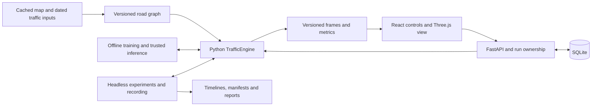

# Architecture, technical-lead review and historical delivery plan

> **Scope update — October 24, 2026:** Emergency vehicles, emergency priority, emergency metrics and emergency RL features are excluded from SmartFlow by the owner’s decision. Any earlier descriptions below are historical and do not define current functionality. Current simulation classes are car, motorcycle, tricycle, bus and truck. Original manuscripts and research artifacts are preserved. See the October 24 scope decision in the architecture document.

Original review: **2026-09-23** (Asia/Singapore), based on September 22–23 evidence. Architecture/status references refreshed **2026-10-24** against current source. The original review was **PLAN** work. Scope: the React/Python application inside **`SmartFlow`** only.

**Current architecture:** FastAPI owns the native engine and process-local run ownership; React consumes authoritative state through shared HTTP/WebSocket compact frames. Saved scenarios use canonical `network_id` and complete `engine_config`. Selected-junction QL/DQL/PPO training, registered inference, replay/reports and baseline-fit evidence workflows are implemented. Routing remains a separate weighted graph search. One compute lease covers API live runs, training/evaluation and recording; playback reads saved frames. Shared 2D/3D presentation displays up to 300 vehicles and 128 pedestrians while retaining full metrics. Keep one API worker.

**Evidence and history:** the September 23 RL-page/worker interruption in [IMPLEMENTATION_HANDOFF.md](../IMPLEMENTATION_HANDOFF.md) was subsequently repaired and exercised on synthetic inputs. Its sections 1–9 preserve historical scope/backlog; section 11 is the maintained source map. [Progress](PROGRESS_AND_HANDOFF.md) records later backend, browser and standalone checks. The [October 21 report](reports/SMARTFLOW_PROGRESS_REPORT_2026-10-21.docx) records 101 frontend tests and API compilation at revision `30da696`, without a full backend/browser rerun. This documentation refresh does not renew software acceptance. Field audit/conversion, baseline fidelity, calibration, independent validation, final comparisons and public hosting remain open.

**September 27 status addendum:** the later browser workflow and separate-location rebuild now pass on synthetic inputs; see [progress](PROGRESS_AND_HANDOFF.md). The original planning paragraphs below remain historical. Public hosting and research validation remain open.

**October 12 architecture decision — interactive 2D presentation:** retain Canvas2D with shared native geometry. Cache world-space `Path2D` geometry and the static background; keep camera and interpolation state in refs, coalesce pointer updates through one scheduled animation frame, and stop continuous rendering when entities are stationary. Vehicle/pedestrian interpolation is bounded by authoritative snapshots and uses the same displayed frame for picking. Pause, run replacement, rewind, explicit seek revision and hidden-tab return discard stale motion history. A successful UI seek increments a separate presentation revision, preserving selection while preventing interpolation even across adjacent running replay frames. Full-width 2D layout and collapsible inspection leave more room for the map. Queue summaries resolve incoming signal-group lanes for the selected junction. These choices change presentation only; native traffic, signal and learning contracts stay separate. See [October 12 evidence and controls](PROGRESS_AND_HANDOFF.md).

**October 10 architecture decision — shared native presentation:** one visualization host loads and normalizes the native visual network, then supplies the same lane polygons, junctions, signal anchors and coordinate conventions to 2D, 3D, minimap and picking. Native coordinates `(x, y)` become Three.js `(x, elevation, -y)`; vehicle centers and complete engine length/width remain authoritative. Camera fitting never extends or changes traffic geometry. Presentation selection, focus, quality and overlays belong to a shared reducer; moving transforms and interpolation belong to renderer refs. Both views snap across seek, run, network and pause boundaries and never extrapolate through a frame gap.

The architectural scene uses locally bundled, licensed GLBs plus authored bus, motorcycle and covered green three-wheel tricycle models. Class/material instances share geometry, preserve stable entity IDs for picking, and dispose resources on replacement/unmount. Laptop is the default: bounded DPR, one key plus ambient light, contact shadows and sparse illustrative context. Enhanced changes shadows, not traffic semantics. A visible WebGL failure preserves a usable 2D view; individual asset failures retain distinct procedural class appearances.

Python serializes complete lane/junction metrics, signal timing meaning, controller request/event provenance and engine-derived illustrative pedestrian paths. Optional fields stay absent for older recordings. Stable distributed display limits are 300 vehicles and 128 pedestrians; full research metrics remain independent of displayed subsets. The actual UTF-8 WebSocket encoding is limited to 262,144 bytes. HTTP state/actions include the same server-authored compact frame, avoiding a second allocation interpretation in the fallback. Oversized metadata produces an explicit error and clears stale scene entities. These additions do not change native engine/configuration/model/action contracts or traffic/RL decisions. The [redesign plan](SIMULATION_VISUAL_REDESIGN_PLAN.md) and [dated result](reviews/SIMULATION_VISUAL_REDESIGN_RESULT_2026-10-10.md) record verification and remaining limits.

**October 9 architecture decision — canonical native scenarios and explicit historical boundaries:** active storage and scenario APIs use `network_id` plus a complete validated `engine_config`. `services/scenario_migration.py` alone interprets historical aliases/disruption fields at upgrade/import/restore boundaries; `tools/migrate_native_scenarios.py` exposes a read-only dry run and transactional apply. Existing legacy columns remain recovery evidence and do not override canonical settings. Ambiguous/enabled disruptions block pending explicit lane/event mapping. Startup repeats safely without overwriting migrated edits or adding duplicate official scenarios.

The inactive SUMO/generic engines, old services, static assets and generated SUMO geometry were archived and removed. That October 9 cleanup retained `native-3`, `native-local-30-v1` and `protected-service-5-v1`; the October 24 vehicle-scope decision below supersedes the engine and observation versions. Immutable artifact envelopes retain `intersection_id`; registered historical paths remain intact and incompatible artifacts remain rejected. Restore rehearsals relocate verified bundle contents through compact directory aliases to avoid repeating long checkout paths on Windows, preserve job subtrees and sidecars, and migrate only the staged database. See the [implementation result](reviews/SUMO_DASH_CLEANUP_RESULT_2026-10-09.md), [migration report](reviews/NATIVE_SCENARIO_MIGRATION_2026-10-09.json) and [removal/recovery manifest](reviews/SUMO_DASH_CLEANUP_MANIFEST_2026-10-09.json). These are software maintenance decisions, with no expansion of RL coverage or field-calibration claims.

The project owner reported **about 35 days remaining** during the September 22 planning discussion. That puts the provisional deadline around **2026-10-27**; the exact submission/defense date is not confirmed. This review keeps that planning anchor rather than restarting the countdown on each edit. The owner is unsure whether the panel requires RL to coordinate all intersections. This is an unresolved scope requirement, not approval to claim network-wide RL.

Navigation: [Start here](../README.md) · [Project purpose](PROJECT_OVERVIEW.md) · [Implementation evidence and handoff](PROGRESS_AND_HANDOFF.md)

**Recommendation:** continue with the custom Python engine and React/Three.js website. Use the integrated software workflow to complete site confirmation, field evidence, model fidelity and reproducible evaluation. Keep the bounded study, separate routing from signal learning and train offline for a hosted demonstration. Broader coverage or coordinated RL depends on academic confirmation and feasibility. The original 35-day schedule below is historical planning context; it does not establish today's available time or completed research gates.

This preserves the agreed direction. It does not certify traffic realism or approve public deployment. The later engine work followed the owner's separate implementation request.

## October 24 scope decision: ordinary traffic only

The owner removed emergency-vehicle support from the capstone. The engine, scenario/import controls, demand generation, signal priority, metrics/reports, RL state/reward, 2D/3D presentation and Field Observer reviewed-class selector follow this decision. Supported simulation classes are `car`, `motorcycle`, `tricycle`, `bus` and `truck`; pedestrians remain supported. Special-response events seen in real footage should be noted as coverage/context exceptions, not silently mapped into ordinary demand.

The engine contract is `native-6` (October 28: the mixed-traffic sub-lane model, D29; `native-5` covered engine fix plan P0-1, P1-2 step 1, P1-3, P1-4 and the per-junction stopped-seconds counter); the RL observation contract is `native-local-22-v3` (22 continuous values; 15 tabular-state components). Observation/reward metadata are `obs_v3` / `reward_v4` (the D27 local, per-interval reward at the wider queue scale of D29). The five protected-service actions and ordinary pedestrian/starvation/clearance safeguards remain. Old model artifacts require retraining and old recordings require regeneration under the current engine. Do not relabel old contracts to bypass compatibility checks.

Legacy `emergency_mode: disabled` is removed during configuration normalization. Enabled legacy settings and emergency vehicle classes/mixes/trips are rejected with validation errors before runtime mutation. Historical databases, raw reports, frozen research records and original manuscript files are preserved. Dormant database columns may remain for restoration compatibility; they are not selectable behavior or current reported outcomes.

Keep a rejected historical scenario as evidence. After reviewing its demand against the revised scope, create a new ordinary-traffic scenario with the supported classes, or explicitly correct a separate imported configuration; do not silently relabel its retired-class trips. An enabled value is rejected even when a native envelope or nested disabled value would otherwise hide it. New training snapshots validate the original scenario before projection. Historical model registry labels remain historical; current QL, DQN and PPO loaders and resume paths must reject incompatible artifacts before inference or resumed training, without rewriting the source model or recording.

Current research guides and manuscript revision recommendations must describe five vehicle classes, the 22-value observation and the reward without an emergency penalty. Historical handoffs, audit records and extracted original manuscript text retain dated wording under a scope notice. New field collection, calibration and controller experiments must use this revised scope. Implementation verification is recorded separately in progress.

## 1. Problem framing and open questions

### Problem, users and critical workflow

SmartFlow must become a defensible capstone system for testing traffic signals and adaptive routes in a bounded Tagum study area. The engine, UI, learning and reporting workflow has dated synthetic acceptance. The remaining research challenge is to establish representative inputs and baseline fidelity, then complete independent validation and fair controller/routing comparisons within the confirmed academic schedule.

Researchers need reproducible experiments; traffic/planning reviewers and panel members need understandable evidence; administrators need access control and preserved results. These audiences do not imply that each has a separately implemented account role.

The critical workflow is **select verified network → save complete inputs → run a baseline → run a compatible policy on matched demand → inspect traffic → save/replay → compare/export → explain results and assumptions**. Training supports this workflow; a training button alone is not the product outcome.

The research question is whether the tested strategies improve selected traffic outcomes under stated conditions. A positive result is not guaranteed. The system must report negative or inconclusive results honestly.

### Scope, non-goals and definition of done

The agreed scope is React, custom Python traffic logic, dynamic connected-road visualization, configurable demand/signals/disruptions, separate adaptive routing, RL signal evaluation and saved evidence. The supplied network contains five junctions, twelve road segments and twenty-four directed lanes. The initial single-car demonstration remains available; the implemented shared 2D/3D scene also supports mixed traffic, pedestrians, inspection and analytical overlays.

Do not spend this release on decorative scenery, a citywide road editor, a second desktop implementation, live CCTV/GPS/IoT ingestion or physical signal control. Map import does not automatically produce a calibrated traffic model.

**Provisional release assumption:** evaluate one RL-controlled junction within the connected five-junction network, with specified control at the others. This matches the current environment. It is **not yet an agreed academic requirement**. If the panel requires every junction to be adaptive or coordinated, revise the scope and plan explicitly; single-junction tests cannot satisfy it.

| Gate | Required outcome |
| --- | --- |
| Software integrity | Inputs survive create/edit/reload/run; safety and conservation hold; bad inputs cannot partially change a run; lifecycle remains consistent. |
| Complete workflow | The same saved scenario runs live/headlessly, produces a replay and exports comparable metrics from an immutable input snapshot. |
| Controller integrity | Every RL-labeled run invokes the selected compatible model; fixed-time runs are identifiable; decisions and safety overrides are distinguishable. |
| Research integrity | Observations and assumptions are separate; calibration and evaluation are separate; comparisons use matched conditions; uncertainty and unfinished demand are reported. |
| Presentation | Minimal 3D positions/turns/signals follow engine state; display caps are disclosed; the team can explain and reproduce results. |
| Release readiness | Current tests/build pass; selected hardware meets measured limits; ownership/security and backup/restore work; release and manuscript agree. |

Software tests do not establish calibration, and a successful defense demonstration does not establish readiness for physical traffic management.

### Facts, assumptions and recommendations

| Type | Item | Consequence |
| --- | --- | --- |
| User-confirmed | Remove SUMO; focus inside `SmartFlow`; pause for the review, then resume engine work and create a portable history; approximately 35 days reported. | Preserve the scope and distinguish the successive work phases. |
| Source-confirmed | FastAPI uses `simulation/traffic_engine.py`, engine ID `native-6`; shared 2D/3D presentation consumes its output. | Preserve these entry points. Obsolete engines were archived and removed; their history remains documented. |
| Source-confirmed, refreshed October 23 | Canonical `network_id` and complete `engine_config` cross the scenario editor, runtime and training/evaluation snapshots. The training page uses saved scenarios and registered model/checkpoint IDs. | Round-trip and job acceptance are recorded in progress; repeat relevant checks after changes. |
| Source-confirmed | One process-local live engine with owner/conflict checks; one selected RL-controlled junction. | Ownership is implemented. Multiple API workers and coordinated network learning require a different design and evidence. |
| Earlier checkpoint inventory | 40 test methods in five files at that checkpoint; the later effort added `test_native_traffic_contract.py`. OSM retrieval recorded as 2026-09-21 at 14:10:12 UTC. | Test count alone is not a pass result; retrieval date is not a field-survey date. |
| Captured earlier verification | All 40 tests passed after the earlier engine fixes; API compilation and three-seed synthetic command passed. | This is September evidence; use progress for subsequent acceptance and current-source checks. |
| Assumption | Team can maintain Python/React and has an offline training machine. | Confirm capacity before promising dates or purchasing compute. |
| Operating scope | One active operator plus authenticated viewers; owner/admin conflict handling and a shared compute lease are implemented. | Keep one API worker and verify deployment-specific behavior on the target host. |
| Recommendation | Freeze scope, start field collection immediately, and require end-to-end acceptance. | Prevent unsupported claims and late rework. |

### Questions that can change the decision

| Question | Owner / deadline | Default while unresolved |
| --- | --- | --- |
| Exact defense/submission date and earlier deliverables? | Project lead, day 1. | Approximate 35-day window ending around 2026-10-27; protect five final days. |
| One RL junction, every junction independently, or coordinated control? Which algorithms are mandatory? | Research lead with adviser/panel, by day 2. | Preserve current single-junction scope without network-wide claims; retain QL/DQL/PPO capabilities pending confirmation. |
| Which dated observations/LGU data can be obtained for the study roads? | Field-data lead, by day 2. | Synthetic scenarios stay labeled; they do not silently fulfill the actual-data objective. |
| Team availability, target hardware and hosting budget? | Project lead, by day 2. | No paid provider or performance promise; use offline training and a bounded demo. |
| Supervised demo or independent simultaneous operators? | Project lead, before hosted trial. | One active operator plus viewers; no multi-operator promise. |

Adviser question to resolve: **“Is RL control of one selected junction within a connected five-junction simulation acceptable, or must the controller optimize all junctions together? Are Q-learning, DQN and PPO all required in the final comparison?”** Record the answer in the decision log and manuscript. This report does not contact the adviser.

## 2. Options and tradeoff matrix

These assessments preserve the September 23 options review and its deadline assumptions. Relative costs are historical planning judgments, not current measurements or hosting quotations. Use the current architecture and progress pointers above for implemented behavior.

| Criterion | A. Current Python engine + React website | B. Established simulator backend + existing React website | C. Installed application using the current engine |
| --- | --- | --- | --- |
| Product value | Matches the online experiment workflow and custom visual display. | Could supply richer traffic behavior while retaining the interface. | Useful offline; does not itself meet online access. |
| Delivery time | Most direct continuation; uncertainty is validation/integration. | Adds compatibility spike, conversion and retraining to the remaining month. | Adds packaging, installation and update work. |
| Implementation complexity | Own traffic physics, graph, demand, safety, routing and metrics. | Own adapters, conversion, lifecycle and capability gaps. | Retains engine risks and adds application distribution. |
| Operations | Persistent Python, web assets, storage and run ownership. | Similar needs plus external engine/runtime compatibility. | Less central demo serving, more machine-specific support; online use still needs hosting. |
| Security/data/reliability | Configuration preservation is fixed; browser acceptance, run ownership and traffic validation remain. | Same web security duties plus conversion/artifact risks. | Local files/updates require care; engine reliability is unchanged. |
| Maintainability/team fit | Fits current Python/TypeScript; requires deep traffic-model ownership. | Less internal physics ownership, more external format/build knowledge. | Extra packaging skills without removing engine work. |
| Migration/reversibility | Keep graph/scenario/frame contracts replaceable. | Feasible behind adapters, but models/results need versioning and regeneration. | Reversible as a wrapper; costly if it forks into another UI. |
| Cost now | Developer and field-validation time dominate; bounded hosting and local training remain plausible. | Integration/retraining may outweigh immediate compute savings. | Packaging/testing/support and local hardware costs. |
| Cost at plausible next scale | Independent runs increase CPU/RAM; recordings/storage and viewer bandwidth grow. Profile first. | May handle larger workloads, but no SmartFlow benchmark proves savings. | More installs increase support; later online use adds server costs anyway. |
| Disposition | **Recommended, subject to early validity gates.** | Contingency if required fidelity exceeds what the native model can deliver. | Defer unless an explicit installable/offline requirement replaces web priority. |

CityFlow is one option-B candidate: its official introduction describes microscopic traffic simulation, configurable networks/flows and a Python RL interface. This does not prove compatibility with SmartFlow's pedestrians, emergencies, map importer or deployment; a bounded spike is necessary. [CityFlow introduction](https://cityflow.readthedocs.io/en/latest/introduction.html).

### Challenge to the current proposal

1. **Removing SUMO transfers traffic-model responsibility to this project.** Passing safety tests can coexist with unrealistic junction capacity or travel times. Junction occupancy was one vehicle at a time until October 25, 2026 (about 456 veh/h/lane); approach-scoped occupancy now discharges a synthetic through movement at about 1,480 veh/h/lane, but that is a plausibility check, not calibration against Tagum discharge headways.
2. **Map automation was not uniquely enabled by removing SUMO.** SUMO supports native OSM import and scenario-generation tooling. The defensible rationale is implementation control and fit with the selected stack, not impossibility of connected OSM roads in SUMO. This correction does not reverse the user's removal decision. [SUMO OSM import](https://sumo.dlr.de/docs/Networks/Import/OpenStreetMap.html).
3. **RL can exploit a simulator's shortcuts.** Reward improvements require field plausibility, a fair baseline, matched demand and held-out evaluation before being interpreted as traffic improvements.
4. **The configuration contract remains essential.** Browser editing/model selection and saved native settings now have dated acceptance; preserve that contract when extending the engine or adding algorithms.
5. **Existing effort does not justify ignoring failure.** If the early validity gate fails, reconsider the model or obtain an explicit scope decision. Additional visual polish cannot resolve a research blocker.

## 3. Recommendation and decision record

Continue option A. Freeze the study network and core contracts, complete the experiment workflow, and spend remaining time on verification, calibration and defense evidence. Do not start another simulator migration, desktop rewrite or general-purpose map editor without a demonstrated requirement.

Prioritize DQN/DQL as the primary neural workflow because it aligns with the previously reviewed chapter direction. Keep Q-learning as a simpler learning comparison and PPO as an available candidate. Confirm mandatory algorithms by day 2; do not silently remove a required comparison. First complete one controller end to end, then reuse that pipeline for the others.

| ID | Decision | Status | Consequence / reversal condition |
| --- | --- | --- | --- |
| D1 | Native Python; no SUMO in active serving/training. | Existing user decision. | Preserve historical evidence; reconsider only explicitly if required fidelity cannot be delivered. |
| D2 | React/Three.js website; routing separate from RL signals. | Existing user direction. | Keep boundaries stable; desktop packaging remains optional. |
| D3 | Five-junction study and minimal scenery first. | Existing direction. | Verify geographic/traffic assumptions before expansion. |
| D4 | Approximately 35-day completion plan with final buffer. | Historical September 23 recommendation, not a renewed countdown. | Confirm exact dates and remaining availability; scope changes need project-lead decisions. |
| D5 | One selected RL junction as provisional scope. | **Unconfirmed academic assumption.** | Resolve by day 2; never label it coordinated network optimization. |
| D6 | One active operator, authenticated viewers, one live API process. | Process-local ownership and conflict checks implemented September 24; hosting assurance remains. | Reset releases ownership; an administrator can explicitly take over. Independent concurrent runs or multiple API workers trigger redesign. |
| D7 | Offline training; trusted versioned policies for hosted inference. | Recommendation. | Avoid live/training resource contention; cloud training requires measured need and budget. |
| D8 | Keep the four foundation documents, the owner-requested history archive and implementation handoff; use AGENTS.md as their compact entry point. | Documentation decision updated September 23. | Separate design rationale, dated verification, active implementation instructions and archived manuscripts. Keep status pointers consistent. |
| D9 | Separate view and run authority for training, recheck stream sessions, and stage all API restores away from the live database. | Implemented September 27; see dated evidence in progress. | Existing standard-user databases need an administrator to grant the new `rl-training:run` permission; fresh databases seed it. Bundles contain network and referenced artifacts; legacy SQLite-only copies remain incomplete. A staged API uses `restore_environment.json` and a separately supplied secret key. |
| D10 | Keep simulation demand and rendering capacity distinct. Measure the native loop and browser independently. | Native measurements September 27; rendering updated October 10–12. Target deployment certification remains open. | The shared server-authored display cap is 300 vehicles and 128 pedestrians, with a 262,144-byte encoded frame limit. Full metrics include undisplayed entities. September's 80-vehicle cap and measurements describe that older build. Later rendering fixtures do not establish realistic traffic capacity; repeat on target hardware and with concurrent viewers. |
| D11 | Package a single-worker API behind a same-origin HTTPS reverse proxy, with exact HTTP/WebSocket browser origins and secure cookies in production. | Local package and preflight implemented September 27; no public host selected. | Process-local live and training state rules out multiple workers. Serve the built frontend through the proxy and keep SQLite, recordings and model artifacts on persistent storage. Resolve applicable dependency advisories and re-measure on target hardware before publishing. |
| D12 | Keep field calibration, held-out evaluation and manuscript conclusions separate from synthetic software acceptance. | Method drafted September 27; owner left final junctions and RL coverage open. | Use the collection and analysis protocol in [Research preparation](RESEARCH_METHOD.md); do not claim Tagum effectiveness until observations and validation support it. |
| D13 | Freeze separate training and evaluation scenario snapshots and disjoint seed sets for RL jobs. | Implemented September 28 for automatic and selected-model evaluation. | Both scenarios must control the same junction. Software separation does not substitute for field calibration, adviser-approved study selection or adequate repetitions. |
| D14 | Scope recording paths to each database and admit one bounded recording per API process. | API admission implemented September 28; API and CLI path policy unified October 1 through `services/timeline_artifacts.py`. | New recordings use `<database filename>.artifacts/timelines` beside the database. CLI manifests and run references use absolute paths, including external database locations. Keep one API worker; existing artifacts retain their explicit paths. |
| D15 | Apply one bounded serialized size policy to CSV expansion and scenario persistence. | Implemented October 1 through `services/scenario_storage.py`; default 2 MiB per JSON field. | Validate expanded UTF-8 JSON before retaining imported CSV files. Preserve `SMARTFLOW_SCENARIO_CONFIG_MAX_BYTES` overrides; split larger observation periods or deliberately raise the cap. New imports retain exact UTF-8 bytes without Windows newline conversion. |
| D16 | Permit checkpoint resume when only verified demand-source file locations change. | Implemented October 1 through `services/scenario_identity.py`, shared by API settings and CLI seed provenance. | Preserve all other snapshot values and require the relocated file to match its recorded SHA-256. Also recognize the exact LF-to-CRLF conversion used by older Windows imports. Missing or changed files and changed arrivals, signals, junctions or provenance still reject resume. Do not rewrite model metadata or promise exact replay-buffer/RNG continuation. |
| D17 | Admit one compute workload across live simulation, training/evaluation and recording in the API process. | Implemented October 1 through `services/workload_admission.py`. | Acquire a lease before allocating run/job records; competing requests receive HTTP 409. A paused live run retains its lease. Release after completion, stop/reset, cancellation exit or failure, including thread-launch failure. Playback consumes saved frames and does not reserve compute admission. Keep one API worker; independent CLI processes and separate API processes require operator scheduling. |
| D18 | Check observed held-out inputs by content and declared collection periods, including mixed synthetic/observed scenarios. | Implemented October 1 through `services/observation_identity.py`, used by queued training, actual-model evaluation and the evaluation CLI. | Reject identical raw or normalized CSV contents and equivalent realized arrival streams. Reject overlapping collection periods for the same network and modality; date-only imports reserve the whole collection date. Optional offset-aware start/end timestamps allow disjoint periods on one day. Synthetic condition experiments remain supported. These checks cannot verify field truth, calibration, or independence beyond supplied provenance. Legacy missing provenance needs re-import; restored frozen snapshots retain content hashes and arrivals despite old paths. |
| D19 | Generate CSV templates from the importer schema and synthetic examples from the loaded network. | Implemented October 2 through `services/observation_templates.py` and the Scenarios sheet. | Header-only downloads contain no fabricated observations. Example downloads select the synthetic source label and use valid current-network IDs. Use authenticated CSV attachments for browser downloads and JSON for metadata; no retained source file is created by a template request. Actual field provenance remains the collector's responsibility. Reuse the importer schema when changing columns. |
| D20 | Expose measurement timing and dataset provenance as additive CSV report columns. | Implemented October 2 in `run_report_row`; full frozen experiment JSON remains available. | Export the saved run snapshot even after scenario edits. Datasets identify their observed or synthetic source kind. Measurement duration may be incomplete for an interrupted run; absent legacy metadata stays blank rather than being inferred. JSON reports retain their existing experiment object. |
| D21 | Prepare roadside observations using one stationary phone camera and a separate offline tool temporarily inside `tools/field_observer/`; use reviewed evidence to calibrate the native engine before controller comparisons. | Owner-approved direction, October 2; October 3 v0.3 adds the isolated tool’s loopback GUI and double-click launcher. Independent field audit gates and SmartFlow conversion remain future work; no vehicle graphics were changed. | Use RF-DETR Small with Supervision detections and the separate trackers ByteTrack implementation in an isolated environment. The local HTML GUI uses a standard-library loopback server for video selection, lines, live boxes/counts, annotated playback, corrections and provisional exports. It shares ingestion/event/export services with the CLI; explicit rotation applies to inference. Original footage remains authoritative, and signals/queues still use manual tables. Keep sequential takes and their periods separate; a network assembled from them is a constructed scenario. Preserve raw evidence separately from derived demand; address actual signal groups, phase durations, movement conflicts and pedestrian demand before claiming site fidelity. The [recording procedure](FIELD_RECORDING_PROTOCOL.md), [tool plan](VIDEO_OBSERVATION_TOOL_PLAN.md) and [integration plan](FIELD_DATA_SMARTFLOW_INTEGRATION.md) define delivery gates. Current selected-junction RL remains the implementation scope; repeated per-junction policies are a proposed extension, not established coordinated network control. |

Reversible choices include scenario parameters, UI layout, host configuration and controller selection. A changed network can be restored as a file but may invalidate models and comparisons unless snapshots survive. Schema changes and artifact removal require migration/backups. Lost observations, overwritten evidence and published unsupported claims are costly or impossible to undo; prevent them rather than relying on code rollback.

**D22 — baseline-fit evidence, October 4:** `backend/research_routes.py` owns permission-scoped search and append-only `calibration_records`. Comparisons freeze current-native fixed-time metrics, full experiment configuration, reference declarations, reviewer and tolerances. Validation preserves network/control/behavior settings and the measurement protocol, allowing independent demand while rejecting reused declared calibration sources and overlapping periods. Access inherits scenario-view/report-view, scenario-edit and report-export permissions; no new grants are seeded. The [research workspace](RESEARCH_WORKSPACE.md) distinguishes automatic whole-network metrics from manually extracted local measures. It tracks numerical fit and review evidence; it does not optimize parameters, authenticate field sources or gate RL training as field-validated. SQLite backups retain the records; external field sources still need separate retention.

## 4. Architecture and delivery plan

**D25 — minimal map with junction column, October 25:** supersedes D24's map chrome. Following the owner-approved [dashboard redesign plan](DASHBOARD_REDESIGN_PLAN_2026-10-25.md), the map shows only three corner chips (intersection, signal phase, phase timer), zoom controls and clickable J-tags in both 2D and 3D. The control bar sits under the map; the idle setup card (New run / Replay recording) replaces the Setup sheet. A right column holds the network map, the selected-junction card (photo, Signal phases / Queue info / Performance tabs) and a Signal control card that enables QL/DQL/PPO only when a compatible trained model exists for the controlled junction. Tabs show only engine-measured per-junction values (services from `phase_order`, lane queues, vehicle passages, waiting pedestrians, vehicle-weighted incoming speed); network-wide wait, throughput and travel time stay in the KPI row. The junction photo is a labelled CC BY 3.0 placeholder from a Davao intersection until field photos named `J1.jpg` / `J2.jpg` are added under `public/assets/junctions/`.

**D26 — single `native-5` engine bump, October 26:** every engine-behaviour change from the [engine fix plan](ENGINE_FIX_PLAN_2026-10-25.md) so far (P0-1 deadlock, P1-2 step 1 capacity, P1-4 maximum red, P1-3 shared pedestrian rule, per-junction stopped seconds) ships under one engine ID, `native-5`. The observation (`native-local-22-v2`) and action (`protected-service-5-v1`) contracts are unchanged, but the model contract includes the engine ID, so `native-4` models, recordings and metric readings become history; they are kept, not relabelled. The dashboard's fixed-time baseline now requires a saved run whose engine version equals the current metric catalog's, so a run without an engine version or from an older engine is never used for the % comparison.

**D27 — local per-interval reward `reward_v3`, October 26:** engine fix plan P1-5. The training reward no longer reads network-wide running averages. Per decision interval Δt at the controlled junction: + 0.5 × vehicles discharged ÷ (Δt / 2.0 s saturation headway), − 1.0 × mean stopped vehicles per approach (Δ stopped vehicle-seconds ÷ Δt ÷ 4) ÷ 30, − 0.5 × longest approach queue ÷ 30, − 0.25 × waiting pedestrians ÷ 20, − 0.05 per phase switch; each normalised term is clamped to [0, 1] and the scales come from `rl_state.py`. The running maximum queue term was removed. The reported KPIs stay network-wide plus J1-local delay, so the reward and the evaluation measure different things on purpose. `REWARD_VERSION` lives in `simulation/rl_reward.py` and DQL, PPO and QL training metadata all read it. The observation (`obs_v2`, including its whole-trip per-approach wait) is unchanged.

**D28 — default RL training budget, October 26:** engine fix plan P1-7. A training run now defaults to 560 episodes of 900 s after a 300 s warmup at 5 s decisions, about 101,000 decisions, so each episode starts from developed traffic instead of a near-empty network (previously 10 episodes of 300 s after 20 s: 610 decisions). The three values are defined once in `simulation/rl_env.py` (`DEFAULT_TRAINING_EPISODES`, `DEFAULT_WARMUP_SECONDS`, `DEFAULT_EPISODE_SECONDS`) and read by the environment, the API settings, the training service, the QL/DQL/PPO trainers and the controller evaluation; the web form mirrors them. Held-out evaluation already uses a different saved scenario and non-overlapping seeds (training 11–55, evaluation 101–105). Model metadata already records the requested episodes, warmup, episode length, decision interval and total timesteps.

**D30 — two-site study: separate site networks, `first_come`, no-signal control, grouped phases, contract v4 and `native-7`, October 31 – November 1:** the study compares today's unsignalized condition (the only one a video can validate) with a proposed fixed-time signal and a proposed RL signal, per [the two-site plan](superpowers/plans/2026-10-31-two-site-study.md). Decisions: (1) each site is its own single-junction network (`data/networks/tagum_site_{a,b}.json`, built from OpenStreetMap, unverified in the field) and each scenario names its network and fingerprint; (2) junction mode `first_come` admits vehicles by arrival order at an approach zone, and the run-level `no-signal` controller applies it to every junction without touching the saved scenario; its approach speed, zone length, turn speed and class speed factors are per-site `engine_config.site_calibration`, never edits of shared constants; (3) `phase_order` may group approaches that share a green, `phase_greens` gives each phase its own green, and a provisional Webster calculator proposes plans (placeholder passenger-car equivalents and saturation flows until cited); (4) RL serves phase slots under `native-local-20-v4` / `phase-service-5-v2`, and every model stores the `phase_plan` its actions mean; (5) training or final evaluation of a study site needs a current, independent PASS from `services/site_validation.py` for the identical physical model, protocol and criteria (design 0.15), enforced in the API and the command-line tools; `--synthetic-smoke-test` runs a code check that marks its artifact. **Compatibility:** the first-come work did not change signalized or all-way-stop traffic: same-seed state digests on the five- and two-junction networks and on the synthetic cross equal the pre-two-site `native-6` code (pinned in `tests/test_native6_compat.py`). The engine still moved to `native-7` once, with the new RL contract, so that no run, recording or model made under one contract can be read as the other. `native-6` models and recordings are refused with the existing "train a new model" / "generate a new recording" messages and are kept as history, not relabelled; dashboard baselines and the stored `native-6` reference runs must be re-recorded on `native-7` (`tools/record_fixed_time_baselines.py`, which needs the owner's approval to write the database). A study site's `native-6` pass, if any existed, would be stale by design (the engine content hash is part of its identity). **Limits:** software readiness is not field validity. The site geometry, the first-come assumption, the approach zone and speeds, the class mapping, the initialization and every threshold are provisional until the team's reviewed observations and a frozen, adviser-agreed criteria file exist.

**D29 — mixed-traffic sub-lane model, `native-6`, October 28:** implements the owner-approved [mixed-traffic design](superpowers/specs/2026-10-26-mixed-traffic-design.md) through the [mixed-traffic plan](superpowers/plans/2026-10-26-mixed-traffic.md). Each direction of a road keeps its real width as one modeled lane; every vehicle has a sideways position and, while turning sideways, a capped drawn angle. Vehicles follow only what overlaps their sideways band, so vehicles travel and queue side by side. Motorcycles seek gaps and filter to the stop line; cars, buses and trucks keep to the centre-line side of their lane portion and tricycles to the kerb, and those classes move sideways only while moving forward. Vehicles enter a junction connector at their real sideways position; merging or crossing movements from one approach follow a fixed order, and a committed vehicle's remaining swept path is kept clear by every other vehicle, including followers on its own approach. A sideways move stops `ALONGSIDE_GAP_M` (0.05 m) short of a neighbour, because lateral bands are lane coordinates and bodies straddling a polyline bend sit slightly rotated against each other. Each driver draws speed and headway multipliers from a separate random stream (`DRIVER_STREAM_SALT`), so arrivals and pedestrians match `native-5` for a seed. The `tagum_provisional` mix (motorcycle 0.55, tricycle 0.25, car 0.15, truck 0.03, bus 0.02) and the class parameters in `simulation/mixed_traffic.py` are **provisional, uncalibrated values**; calibration waits for confirmed sites and reviewed Field Observer counts. Accepted limitation: exit storage still counts vehicles end to end, so a road backed up with vehicles side by side counts as full earlier than it is. Because the Tagum mix queues reach a per-approach p95 of 62 vehicles, the observation's queue and active-vehicle scales are 70 (`obs_v3`, `native-local-22-v3`, `reward_v4`). `native-5` models, recordings and metric readings become history; they are kept, not relabelled. Acceptance (1800 s, seeds 101/102, 20 cases) is in [the report](reports/mixed-traffic-acceptance.json).

**D24 — LGU-facing dashboard and provisional two-junction site, October 24:** the primary audience is an LGU traffic administrator, so the Dashboard is one shadcn layout: four KPI cards (average wait, average queue, completed-trip rate, completed trips) with a percentage change against the latest completed fixed-time run of the same scenario and seed; the map with a junction panel (current service, timer and waiting vehicles per approach labelled by compass side with clear/low/moderate/high bands); one control bar (Live/Replay, start/pause/stop, speed, Setup sheet); and a collapsible trend chart. 2D is the primary view and 3D an optional illustrative view with regular set-back blocks. The sidebar groups Operate, Research and Admin pages. The final two study intersections are not yet confirmed; `data/networks/tagum_network_2j.json` (J1 Arellano/Osmeña and J2 Mabini/Osmeña, built by `tools/build_study_network.py --junctions`) is a provisional placeholder selected with `SMARTFLOW_NETWORK_PATH` and an isolated database. It keeps the `tagum_network` id because RL state encodes that id; the five-junction file remains the default. Swapping in the final site means regenerating that file, not changing the UI.

**D23 — result interpretation, October 24:** `simulation/metric_definitions.json` is the versioned native metric catalog shared by Python reporting/calibration and TypeScript Help/live/saved/comparison views. `services/metric_definitions.py` and `src/lib/metrics.ts` interpret availability without changing stored numeric evidence: missing/non-finite values, empty/unrecorded average populations, unsampled queues and zero-duration rates are unavailable. Explicitly different historical engines are not assigned current native meanings. `/api/metrics/definitions` exposes the same catalog to authenticated clients. New exports retain raw metrics and add definitions/version and missing-value reasons; calibration records retain their frozen definitions and new records identify the catalog version. Original artifacts and older frozen fit records are not rewritten.

Controller summaries retain each repetition, available/total counts and unweighted per-run mean/min/max/population standard deviation; unavailable averages are excluded and incomplete wait coverage is not ranked. The score remains negative mean stopped vehicle wait. `waiting_time_rank` orders that mean with completed trips as the tie-breaker, uses shared ranks for ties and leaves unavailable cases unranked. `traffic_performance_rank` remains an explicitly labeled legacy alias. New summaries carry a criterion/version, per-metric differences and zero-reference percentage unavailability, and `overall_recommendation: null`; no weighted score or acceptable-degradation rule is invented. Standard deviation is not a confidence interval. At this interpretation checkpoint the only engine addition was an active-emergency population counter; the subsequent ordinary-traffic scope decision above removes that counter and its metrics, advances native compatibility and leaves the ordinary traffic mathematics intact.

### Boundaries and interfaces

Run ownership, shared frame delivery, headless experiments and trusted registered inference in this diagram are implemented responsibilities with dated synthetic verification in progress. Deployment and field validity require separate evidence.

| Boundary | Current files | Required contract |
| --- | --- | --- |
| Core simulation | `simulation/traffic_engine.py` | Fixed steps, validated inputs, lifecycle and snapshots; independent of rendering and database access. |
| Graph/map | `simulation/road_network.py`, import/build tools | Metric coordinates, stable IDs, provenance, connected directed routes and explicit restrictions. Map refresh cannot change an existing experiment silently. |
| Inputs/demand | `simulation/scenario_config.py`, `simulation/demand.py` | Atomic validation; arrivals independent of policy/queues; separate pedestrian randomness; provenance and demand fingerprint. |
| Live application | `backend/main.py`, runtime/schemas/security modules | Authorized commands, run ownership, consistent lifecycle/errors and persistence. |
| Browser | `src/components/`, `src/api/`, `src/simulation/` | Preserve full settings, select a real model, render engine state and disclose display caps. |
| Learning | RL environment/state/reward/policy/training modules | Compatible observation/action/model contract, safe actions, correct warmup/time limits and separate evaluation. |
| Artifacts | Timeline services, playback engine, evaluator | Snapshot inputs/model provenance; reject incompatible artifacts; replay/report metrics agree. |

Keep `/api/simulation/configure`, lifecycle routes, `/ws/simulation`, `/api/visual-network`, scenario CRUD, model/training routes and run/report APIs. Prefer additive changes with round-trip tests over an API rewrite. Hosted start currently requires a saved scenario.

### Native model reference

- **Time:** `native-6`, 0.1-second steps, metres/seconds/m/s. Start/reset restores baseline constraints before replaying events. Version changes intentionally invalidate incompatible model/recording artifacts.
- **Graph:** five junctions, twelve roads, twenty-four directed lanes, covering parts of Arellano, Jose Abad Santos, Lapu-Lapu, Mabini and Osmeña streets. Assumptions include one lane per direction, 3.3 m width, 8.33 m/s study speed and experimental signals. Supplied prohibited turns are supported; actual lane/turn/signal details need field review.
- **Vehicles:** IDM-style following plus hard gaps; car, motorcycle, tricycle, bus and truck dimensions/speed factors. This does not imply lane changing, overtaking or motorcycle filtering.
- **Junctions:** exclusive reservations, signal/stop permission, downstream storage and pedestrian clearance. Simplified all-way-stop comparison exists. Since October 25, 2026, occupancy is approach-scoped at signalized junctions (vehicles from the approach with green may be inside together; others and pedestrians wait until it is empty) with a lane-storage entry rule; all-way stops keep one vehicle. Synthetic saturation headways (`tests/test_junction_capacity.py`) need field calibration.
- **Signals:** phase order/timing/offset, green limits, yellow/all-red, pedestrian service through safety rules. Log safety overrides separately from learned decisions.
- **Routing:** travel-time/queue costs; avoids closed/prohibited movements. Default reroute interval is 15 seconds with a 15% improvement threshold. `static` suppresses congestion rerouting but still permits closure detours.
- **Demand:** single-car replacement is a demonstration, not a matched-arrival comparison. Seeded schedules/windows and explicit trips supply experiments. Blocked arrivals wait subject to reported capacity limits; crossing distance/speed and pedestrian waiting threshold are configurable.
- **RL:** 22 continuous observation values, 15 tabular-state components, five service actions, one selected junction. Metadata identifies `native-local-22-v3`, `obs_v3`, `reward_v4`, `protected-service-5-v1` and the default network fingerprint. The reward (`reward_v4`, the `reward_v3` terms at the `obs_v3` queue scale) uses only the controlled junction over the last decision interval: vehicles discharged, stopped vehicle-seconds, longest approach queue, waiting pedestrians and phase switches. Compatibility metadata alone does not establish artifact trust.

Custom graph JSON is supported through Python/headless paths, including the configured `SMARTFLOW_NETWORK_PATH`. The visual endpoint serves the configured native network and accepts its exact ID, or an omitted ID. Historical `tagum_1`, `tagum_2` and `tagum_3` aliases are interpreted only at migration/import/restore boundaries; active APIs reject them. Obsolete generic/SUMO engines, `services/simulation_service.py` and `sumo/` assets were archived and removed. Their recovery manifests and historical artifact envelopes remain; avoid reconnecting TraCI to active paths.

### Data changes and compatibility

| Data | Present state | Continuing requirement |
| --- | --- | --- |
| Saved scenarios | Canonical `network_id` and complete JSON `engine_config` in SQLite/API/editor, runtime and training/evaluation snapshots. | Preserve validated round trips and omitted-versus-explicit update semantics after changes. Legacy recovery columns do not override native settings. |
| Native config | Signal plans/control junction, vehicle mix, provenance, demand windows/trips, constraints/events, routing/crossing parameters and limits. | Validate types, finite values, IDs/ranges and unknown fields; document intentionally additive overlapping windows. |
| Legacy disruption JSON | Retained as recovery evidence; a shared migration resolver handles historical inputs only at explicit boundaries. Ambiguous/enabled restrictions block pending lane/event mapping. | Preserve originals and actionable errors; active requests use native lane restrictions and events. |
| Graph | Versioned JSON/provenance and refresh scripts. | Retain extract, derived graph, field corrections and assumptions; never rewrite a historical run's graph. |
| Runs | Experiment snapshots and report/comparison identities retain full config, seed, timing, engine/network/demand identity and model provenance. | Preserve immutable evidence across scenario edits, relocation and export; inspect actual artifacts before reusing a result. |
| Models | Registered UI selection uses `ql:<id>`, `dql:<id>` or `ppo:<id>`; compatible inference, junction/timing checks and checkpoint resume exist. | Reject stale/incompatible artifacts and untrusted paths; retain actual-controller/request/override evidence. |
| Recordings/comparison | Native compatibility checks and full-input comparison keys. | Distinguish a matched policy comparison from a deliberate changed-scenario/network experiment; label changed inputs explicitly. |
| Observations | Four CSV schemas/templates, source retention/hashes and declared held-out guards; isolated Field Observer proposals/review; durable baseline-fit records. | Complete independent field audit and faithful conversion, then calibration/validation. Preserve dates/method/units and distinguish measured local counts from inferred boundary OD trips. |

Keep metric definitions stable: `avg_wait` is stopped time for relevant admitted vehicles; `avg_queue` is time-averaged queue per incoming lane; `max_queue` is the largest stopped lane queue; `throughput` counts completed trips in the measurement window; `avg_travel_time` uses full trip times of window completions; `avg_ped_delay` is waiting time. Include pending, dropped and unfinished demand. Audit warmup/denominators across live state, saved metrics, replay and exports.

### Operating design and cost controls

For the first trial, use one persistent API process, explicit live-run ownership, persistent SQLite/artifact storage and HTTPS. Keep substantial training separate. Redis, Kubernetes, distributed simulation and a replacement database are not justified by current demonstrated requirements.

The current runtime claims one authenticated operator for configure, lifecycle, playback and speed changes. Other users can view its state but receive a conflict on mutation; reset releases the claim, and an administrator can explicitly take over. This claim is in process memory, so deployment must stay at one API worker until ownership and runtime state move to a shared store. CSV imports validate complete candidate settings before preserving source bytes or saving a scenario. Count bins become evenly spaced synthetic arrivals; turn rows identify a permitted junction movement on their supplied boundary route, while later adaptive rerouting can change the actual movement. Source hash, date, network hash and conversion are kept with demand provenance. Comparison/export keys and reports retain model, seed, engine, network and demand identity and show unfinished demand.

FastAPI documents that separate worker processes normally have separate memory. Applied to this repository's singleton engine, multiple workers would create separate runtimes, not a shared simulation. This is an inference from that process model and current source. [FastAPI deployment concepts](https://fastapi.tiangolo.com/deployment/concepts/).

No hosting price can be responsibly selected without a provider, region, budget and measured workload. Measure CPU/RAM, step/frame time, recording growth and training wall time. Budget for API uptime, storage, backups, bandwidth and any approved training compute. Recording volume is approximately `recorded frames × average bytes per frame × retained runs`, adjusted using measured compression. Independent concurrent runs, rather than registered account count, are the immediate compute scaling issue.

### Historical September 23 delivery slices within 35 days

The following table preserves the original plan. For that schedule only, day 1 is September 23 and day 35 is October 27, 2026. These are historical calendar windows, not a current remaining-time estimate or evidence that each slice/gate was completed. Confirm the actual deadline and availability before rescheduling; use progress for delivered software and the field integration plan for remaining research. The day-number deadlines elsewhere in this original review refer to this planning anchor. If one person holds multiple owner roles, do not assume parallel capacity.

| Slice / window | Useful delivered result | Owner | Dependencies | Acceptance evidence |
| --- | --- | --- | --- | --- |
| S0, days 1–2 | Confirmed academic scope, release checklist and preserved checkpoint. | Project/research + implementation lead | Adviser, deadline and team availability | Record exact deadline, RL scope, algorithms and field schedule; preserve current edits and distinguish tests from plans. |
| S1, days 1–4 | Save, edit, reload and run the exact scenario. | API/frontend owner | Current schemas/database | Complete `engine_config` round-trip; clear legacy-field behavior; invalid requests do not change prior settings. |
| S2, days 3–7 | Reproducible fixed-time run with disruption and recovery. | Engine owner | S1, frozen graph | Safety/conservation hold; closure/reopening accounts for demand; metrics/fingerprints repeat; preliminary field plausibility reviewed. |
| S3, days 6–10 | Replay and export that baseline. | API/frontend owner | S2 | Original metrics agree with replay/export; errors finalize jobs; scenario edits do not alter existing evidence. |
| S4, days 8–14 | One real DQN workflow, reused for required QL/PPO comparisons. | ML/engine owner | S2–S3, confirmed academic scope | Train/save/load/select/infer demonstrated; decision/override traces; stale-model rejection; Gym/warmup/time-limit checks. |
| S5, days 1–14 | Dated field dataset and calibration/evaluation split. | Field-data/research lead | Access, survey plan and adviser protocol | Raw counts/turns/pedestrians/queues/travel observations retained; missing data/assumptions labeled; held-out data kept separate. |
| S6, days 15–22 | Matched reproducible evaluation report. | Research + ML owner | S4–S5 | Required algorithms/scenarios, multiple seeds, paired inputs, uncertainty and unfinished demand; negative results retained. |
| S7, days 18–26 | Stable minimal 3D and limited hosted demonstration. | Frontend/deployment owner | S3–S4, bounded runtime | Current build/browser checks, faithful state, target-device performance, ownership/auth/reconnect and restore evidence. |
| S8, days 27–30 | Release candidate, manuscript alignment and rehearsal. | Project lead + owners | Required earlier gates | Fresh-machine setup, local fallback, reproducible result, backup package and no high-impact open defect. |
| Buffer, days 31–35 | Fix and rehearse only. | Project lead | Frozen candidate | No new features/architecture; resolve demonstrated defects and protect submission time. |

Decision gates: **day 2** academic scope; **day 7** native model validity; **day 14** data/controller viability; **day 22** evaluation freeze; **day 30** release-candidate freeze. A failed gate triggers an explicit project-lead/adviser decision. It does not authorize silently shrinking the research objective. Do not schedule the first complete workflow in the final five days.

## 5. Risk register with mitigations and owners

Likelihood is qualitative, not measured. Release blockers apply to the stated capstone/hosted scope.

| Risk and basis | Likelihood / impact | Mitigation and trigger | Owner |
| --- | --- | --- | --- |
| Academic RL scope unknown, confirmed by user. | High uncertainty; potential redesign. | Adviser decision by day 2. If coordination is mandatory, reassess state/action/reward and critical path immediately. | Research/project lead |
| Exclusive whole-junction reservations distort capacity. | High modeling risk; invalid conclusions. | Early discharge/queue/travel checks against observations. Model or explicitly agreed scope decision by day 7. | Engine + research |
| Scenario settings regress during new work. | Editor/runtime/training round trips have dated synthetic acceptance. | Preserve canonical settings and repeat relevant create/edit/reload/run checks after changes. | API/frontend |
| Actual data arrives too late. | Unknown availability; blocks actual-data claim. | Collect now, checkpoint day 7, dataset gate day 14. Synthetic-only fallback needs explicit academic acceptance. | Field-data lead |
| RL gains reflect selected seeds, changed demand or censored trips. | Material research risk. | Held-out protocol, paired inputs, unfinished/external demand and sensitivity analysis; compare traffic outcomes beyond reward. | ML/research |
| Multiple operators or workers diverge from the shared-runtime design. | Owner/admin conflict rules and one compute lease exist within one process. | Keep one API worker, verify target-host role/conflict behavior and design independent runs only if required. | API/deployment |
| Target-host session/job security differs from local checks. | WebSocket session rechecks and training `run` permissions are implemented; public-host security review remains. | Rehearse origin/CSRF behavior, proxy deployment and all role workflows in the target environment. | Security/API |
| Models are stale or untrusted. | Historical artifacts present; inference/data risk. | Native contract, trusted storage, model identity/hash and rollback. Metadata compatibility is not authenticity. | ML/deployment |
| CPU/RAM/disk exhaustion from demand, jobs or recordings. | Local synthetic measurements exist; target-host and field-load capacity remain unverified. | Retain admission/size limits, measure the intended workload, bound retention and report overflow. | Engine/deployment |
| OSM geometry is mistaken for observed traffic/signals. | Confirmed experimental assumptions; misleading claims. | Verify roads/turns/signals; retain attribution/date; label inferred values and version corrections. | Field-data/research |
| Crash, schema change or deletion loses evidence. | Possible; high recovery cost. | Coherent database/artifact backup, immutable raw observations, restore drill and interrupted-job reconciliation. | Deployment/project lead |
| Software passes are treated as full capstone acceptance. | Dated backend, frontend, browser and standalone checks exist; field and public-hosting gates remain open. | Tie each check to its source/date/scope; complete research and target-release evidence separately. | Implementation lead |

Hidden costs include field collection, map correction, traffic-model calibration, repeated training, retraining after graph changes, report consistency, storage, recovery drills and manuscript explanation. Removing an external dependency does not remove these obligations.

## 6. Test, rollout, rollback and monitoring plan

### Release evidence

Historical test totals, including the original 40-test checkpoint, do not prove every acceptance condition below. Progress records later suites and browser checks with their actual scopes. Add meaningful tests for demonstrated gaps as implementation continues. Keep the command, environment, source revision or worktree snapshot, result and artifact references with release evidence.

| Gate | Verification required | Acceptance / owner |
| --- | --- | --- |
| Configuration and reproducibility | Create/edit/reload/run advanced settings; reject invalid inputs atomically; reset/repeat the same scenario and seed. | No lost fields or partial mutations; repeatable demand and result fingerprints under the same version. API/engine owner. |
| Traffic safety and progress | Dense mixed traffic, downstream blockage, closures/reopening, red/yellow/all-red, pedestrian clearance and stop control. | No overlapping reservations, unsafe permissions, lost vehicles or conservation error. Demonstrate progress where routes and downstream capacity permit it; explain genuine oversaturation. Engine owner. |
| Metrics | Hand-check small scenarios, warmup boundaries, completed/unfinished trip cohorts, queues, waits and external demand. | Finite values, explicit denominators and agreement among live output, saved runs, replay and reports within documented numeric precision. Engine/research owner. |
| Controllers | Short real train/save/reload/infer runs for each required algorithm; action bounds, safe transitions, selected junction, model identity and stale-artifact rejection. | The selected model actually controls the run; requested actions and applied safety overrides are separately inspectable. ML owner. |
| Research validity | Field plausibility, calibration record, held-out comparisons, repeated seeds, unfinished demand and uncertainty. | Results support only the tested conditions; software test success is not substituted for validation. Research lead. |
| Complete browser workflow | Login, scenario editing, model selection, start/pause/reset, stream disconnect/reconnect, save, replay, compare and export. Inspect turns/signals/closures and display caps. | Current build passes; no silent state divergence or misleading controller/metric label. Frontend/API owner. |
| Access and artifact safety | Two users contest a run; unauthorized commands/jobs fail; test logout, expiry/revocation, allowed origins and applicable CSRF defenses; reject untrusted model paths. | Owner/viewer/admin behavior matches the documented policy and expensive operations require intended authority. API/deployment owner. |
| Performance and recovery | Measure agreed demand, viewers and recording on target hardware; interrupt jobs/processes; restore database and artifacts. | Bounded resource use, visible failure states, recoverable evidence and recorded operating limits. Deployment owner. |
| Release package | Fresh-machine setup, reproducible experiment command, required dependencies, manuscript/figure correspondence and local fallback rehearsal. | Another teammate can reproduce the nominated result and explain its limitations. Project lead. |

**Proposed performance criteria, not measurements:** at the agreed demonstration load, sustain at least one simulated second per wall-clock second and keep the 95th percentile engine-step-plus-frame cost below the 100 ms step budget. Measure the whole run loop as well: sleeping after computation can miss real-time speed even when isolated steps are fast. Record machine specifications, active vehicles/pedestrians, viewers, recording mode, memory and browser frame rate. If the selected profile advertises 300 active vehicles, test that load; otherwise disclose the measured cap. A smaller working demonstration must not conceal an unsupported research workload.

**Local measurement, September 27:** `tools/measure_native_capacity.py` records step, full/compact frame, simulation/wall ratio, process peak RSS, recording bytes and demand conservation. The 300-second synthetic Very High case on the current Windows machine reached 108 active vehicles, 7.85× whole-run speed, 12.93 ms p95 step, 13.79 ms p95 full-frame serialization and 33.8 MiB peak RSS. It retained 132 pending arrivals with zero deferred demand and zero conservation error. Storage consumed 139.3 MiB raw / 24.6 MiB gzip for that five-minute recording. A visible production-browser 3D run rendered the declared 80-vehicle cap at median 56 fps across five warm samples, with 102 vehicles still simulated. Rendering and recording storage deserve more attention than native CPU at this measured load. These values are machine- and synthetic-case-specific; the actual deployment machine, viewer count and field-calibrated load remain unmeasured.

### Evaluation protocol to settle with the adviser

Use ordinary, peak and disruption/recovery scenarios with the same frozen graph, exogenous arrivals, vehicle mix, pedestrian demand, warmup, duration and safety rules for each controller comparison. Include a credible fixed-time baseline. Use a separate static-versus-adaptive routing comparison, or a clearly labeled factorial experiment, so signal and routing effects are not confused.

Start planning with at least five held-out demand seeds per condition; this is a practical starting allocation, not a claim of statistical sufficiency. Decide repetitions from variability, available time and the agreed protocol. Use multiple training seeds when making claims about an algorithm rather than one trained artifact. Report per-run results and paired differences with an appropriate uncertainty estimate; retain failures and negative results. Do not tune on the held-out evaluation set or report only the best seed. If resources limit repetitions, state that limitation instead of overstating confidence.

Verify custom-environment behavior, separate evaluation from training, and distinguish time-limit truncation from natural termination. These checks and repeated evaluation follow the general guidance in the [Stable-Baselines3 RL tips](https://stable-baselines3.readthedocs.io/en/master/guide/rl_tips.html); they do not establish SmartFlow model validity or mandate a dependency upgrade.

### Rollout

1. **Local checkpoint:** preserve the current worktree and data, verify the latest suite, and close configuration/model-selection integrity gaps using temporary test data.
2. **Research checkpoint:** freeze graph, scenario definitions and metric semantics; retain calibration records and raw observations. Generate versioned models and evaluation artifacts from those inputs.
3. **Limited hosted trial:** one owned run, authorized viewers, HTTPS, production secrets, persistent storage, bounded jobs/recordings and tested backups. Keep training offline. Do not expose arbitrary model uploads as part of this release.
4. **Release candidate by day 30:** complete the end-to-end browser checks, target-machine load check, restore drill and defense rehearsal. Prepare a local run and a clearly labeled recorded replay as contingencies.
5. **Submission:** preserve exact source/build, dependencies, data/config/model hashes, experiment commands and manuscript figures. Use the final five days for corrections and rehearsal.

These are future gates, not a statement that deployment or field validation has happened. No deployment is authorized or performed by this planning document.

### Rollback and evidence recovery

Before schema or artifact-layout changes, stop new writes/jobs and create a coherent checkpoint of the database, recordings, models, graph and manifests. Use SQLite's supported backup mechanism or a cleanly closed database snapshot; copying an actively changing database file alone is not a recovery plan. See the [SQLite Online Backup API](https://sqlite.org/backup.html).

The September 27 API bundle uses SQLite's backup API and checks references before success. It stages a verified ZIP under the database storage directory's `backups/restores/`, rewrites artifact paths, invalidates copied sessions and writes `restore_environment.json`. Launch a separate API process with its staged `SMARTFLOW_DB_PATH` and `SMARTFLOW_NETWORK_PATH`, plus a fresh secret key. Legacy `.db` files stage without artifacts and cannot certify model or replay recovery. Do not point production at a staged copy until its scenario/model/replay and role workflows have been inspected. Do not replace the live database while the process-local simulation or worker is running.

Test restoration in a separate location and confirm that database references resolve to the restored files and that a saved run can be replayed. Keep a last-known-working source/build and a matching data/artifact checkpoint. Revert them together when compatibility requires it; a code-only rollback may not undo a schema or model-contract change.

After a failed release, stop admission of new runs, preserve diagnostic logs and failed artifacts, restore the compatible checkpoint, and repeat a baseline/replay smoke check. Mark interrupted jobs explicitly. Do not promise exact simulation resumption after a crash unless that capability has been implemented and tested. Preserve original observations and evaluation output; do not use a broad Git reset or delete them to make the workspace appear clean. The deployment owner executes recovery; the project lead decides whether to reopen the demonstration.

### Minimal observability

| Signal | Required response | Owner |
| --- | --- | --- |
| Run ID, owner, controller/model identity, seed, input/graph/engine versions and demand fingerprint | Missing provenance makes a run ineligible for final comparison until resolved. | API/research |
| Conservation, invalid state and safety-invariant errors | Any violation blocks use of that run as research evidence; preserve diagnostics and correct the cause. | Engine |
| Step/frame cost, simulation-to-wall-time ratio, CPU/RAM and recording size | Reduce admission or revise the declared operating limit when measured limits are exceeded; never silently drop simulated demand for speed. | Deployment/engine |
| Pending, dropped, admitted, completed and unfinished demand | Separate oversaturation and configured capacity limits from defects; include these counts in reports. | Engine/research |
| Requested/applied policy actions and safety overrides | Investigate persistent suppression, incompatible models or an RL label with no policy inference. | ML |
| Stream disconnects, authorization denials and ownership conflicts | Recover UI state explicitly; investigate repeated failures without logging credentials/tokens. | API/frontend |
| Job progress/final state, disk space, backup age and restore result | Stop unsafe new work before storage exhaustion; reconcile stuck/interrupted jobs; repair stale backups. | Deployment |

Structured application logs and per-run summaries are sufficient initially. Assign actual thresholds from the target-hardware trial; a separate monitoring platform is deferred until a demonstrated operational need exists.

## 7. Files changed and verification results

The **original PLAN pass** produced this technical-lead review and aligned documentation. It performed no application implementation, training, field collection or deployment. The table and verification immediately below record that earlier pass, not the later engine work.

| File | Documentation change |
| --- | --- |
| [Architecture and delivery plan](ARCHITECTURE_AND_PLAN.md) | This eight-part review, alternatives, decision record, approximately 35-day schedule, risks and acceptance/recovery gates. |
| [README](../README.md) | Entry-point description of the review and current planning checkpoint. |
| [Project purpose and scope](PROJECT_OVERVIEW.md) | Deadline context and explicit uncertainty about required RL coverage. |
| [Progress and handoff](PROGRESS_AND_HANDOFF.md) | Originally recorded the planning pause; now updated with the later engine checkpoint. |

Documentation verification on September 23 passed: four main documents, all eight numbered review sections, valid internal file links, consistent review/deadline dates and balanced Markdown code fences. SHA-256 comparison of 133 source/dependency files against the pre-review baseline found no changed, added or missing files in that checked set. The result is also recorded in the handoff.

The repository already contained substantial uncommitted migration work. Its presence in Git status is not evidence of changes made by the original review. At that planning checkpoint, the latest combined regression was unconfirmed and the 27-method source count was not a pass result.

**Subsequent September 23 authorized implementation:** the baseline 27 tests passed, demonstrated gaps were corrected, and all 40 updated tests passed in 72.961 seconds, including short real learning smoke tests. API compilation and the three-seed headless example passed. The [progress record](PROGRESS_AND_HANDOFF.md) retains changes, commands, limits and later milestones. The owner-requested [history archive](../PROJECT_HISTORY_AND_MIGRATION.md) preserves both manuscripts and codebase progress. That September checkpoint did not include new frontend acceptance, field calibration or deployment; later software acceptance is recorded separately above and in progress.

## 8. Deferred decisions and triggers for revisiting them

| Deferred decision | Trigger / latest decision point | Accountable owner |
| --- | --- | --- |
| Exact submission date and mandatory RL coverage/algorithms | Adviser/project confirmation by day 2; any requirement for all-junction or coordinated RL immediately changes the plan. | Project/research lead |
| More detailed junction conflict/capacity behavior | Day-7 plausibility gate fails or observations show the simplified model cannot answer the research question. | Engine/research |
| Different simulator backend | Required fidelity cannot be delivered in time; only then run a bounded compatibility spike and make an explicit scope decision. | Technical/project lead |
| Independent simultaneous live runs | A confirmed workflow requires two operators to run separate experiments; introduce per-run ownership/state and measure resource needs before scaling workers. | API/deployment |
| Hosting provider and paid compute | Measured workload, budget and persistence requirements are available before the hosted trial. | Deployment/project lead |
| Algorithm breadth and extra tuning | Confirm QL/DQL/PPO requirements by day 2; add optional work only after the required reproducible comparison is complete. | Research/ML |
| Larger network, arbitrary map selection or road editor | Current bounded study is validated and a documented research need justifies the added scope. | Research/frontend/engine |
| Desktop installer or offline packaging | Explicit distribution/offline requirements cannot be met by the rehearsed local web setup. | Project lead |
| Database replacement, queue service or distributed training | Measured contention, independent-run concurrency or recovery needs exceed the current design. | Technical/deployment lead |
| Decorative scenery and additional visual assets | All required research and release gates pass with time remaining outside the protected buffer. | Project/frontend lead |

Maintain decisions here, project purpose in the overview, verification evidence in the handoff and startup instructions in README. A recommendation becomes an accepted scope decision only when its accountable owner records the decision; an implementation becomes accepted only when its required evidence is captured.
