# SmartFlow manuscript revision guide

Prepared October 8, 2026, Asia/Singapore. Companion to the separate manuscript/codebase assessment. This document specifies manuscript changes, replacement diagrams, database corrections and evidence still needed for the objectives. It does not change the application or overwrite either archived manuscript.

## 1. How to use this guide

The reference manuscript is the 74-page `FINAL_SIGURO_CHAPTER1_AND_2.docx.pdf`. Page numbers below are **PDF positions including the cover**, not the manuscript's printed page numbers. The root copy and archived revised copy have identical content.

Use three labels while revising:

- **Implemented:** functionality exists in the current source; describe its actual scope and cite relevant verification.
- **Research evidence pending:** a feature exists, but the field data, model validation or comparative study needed for the objective is unfinished.
- **Proposed:** a software or research extension has not been implemented. Keep future tense and identify it as planned.

Do not weaken an objective simply to make it appear completed. Preserve the six approved intentions and disclose the remaining evidence. Changes to final sites, required RL coverage or mandatory algorithm comparisons need academic agreement. Replace obsolete implementation descriptions now; add actual study results only after the relevant work is completed.

The active architecture is **React/TypeScript/Vite + Three.js -> FastAPI -> native Python traffic engine**, with SQLite records and external artifacts. SUMO/TraCI belongs to the historical implementation and related literature. Vehicles and pedestrians are simulated traffic entities; the signal controller is the RL agent. Routing is a separate graph algorithm.

## 2. Objectives: what the code achieves and what is still lacking

These paraphrase the six objectives on PDF page 5. “Software achieved” does not mean the entire research objective is fulfilled.

| Objective | Software achieved in current source | Still lacking | Safe manuscript assessment |
| --- | --- | --- | --- |
| **1. Model a specific real Tagum intersection using maps, geography and traffic statistics.** | Connected five-junction OSM-derived graph; metric road/lane geometry; turn connectors/restrictions; 2D/3D displays. | Documented mapping to the final selected sites; field-confirmed lane counts/storage, crossings, permitted movements and actual control; baseline fidelity evidence. | **Partially fulfilled.** Map-based modeling exists; actual-site representativeness remains to be established. |
| **2. Use actual traffic data to model volumes and conditions.** | Four CSV input schemas; retained source CSVs and hashes; explicit vehicle/pedestrian schedules; a separate video proposal/review tool. | Independently audited observations; adequate input coverage; faithful class/time/location conversion; justified OD assumptions; calibration and independent validation. | **Partially fulfilled.** Data-handling capability exists; imported or declared “observed” data alone does not establish measured accuracy. |
| **3. Provide configurable traffic and signal settings.** | Scenario create/edit/reload, full native settings, selected junction, supported signal plans, routing thresholds, demand windows and timed lane events. | Site-required settings outside the present contract; usability/acceptance evidence for any newly added settings. | **Substantially implemented for the supported contract.** Avoid implying arbitrary lane layouts or signal phases are editable. |
| **4. Test road closures/modifications and rerouting alternatives.** | Lane closure/reopening, speed restrictions, closure avoidance, alternative paths, congestion-based rerouting and cooldown/improvement thresholds. | Actual-site disruption cases and outcome comparisons; general road-alignment/lane-layout editing if the final scope requires it. | **Core closure/rerouting functionality implemented.** Broader physical road redesign and site-specific research findings are incomplete. |
| **5. Model peak demand, holidays, closures and event conditions.** | Configurable demand windows and scheduled road events; reproducible synthetic cases. | Actual peak-period observations or documented event assumptions; representative experimental cases and findings. | **Scenario mechanism implemented; research inputs/results pending.** Label invented holiday/event demand as hypothetical. |
| **6. Use RL signal learning and inform signal arrangements.** | QL, DQL/DQN and PPO training; checkpoints/resume; model registry/compatibility; selected-junction inference; repeated controller evaluation, held-out scenarios/seeds and comparison infrastructure. | Credible observed baseline; completed independent validation; final comparative training/evaluation; supported existing-versus-proposed signal findings. | **Learning/evaluation infrastructure implemented; effectiveness and planning claims pending.** No proven optimal arrangement or real-world improvement percentage. |

### 2.1 Evidence owners and completion criteria

| Objective | Relevant current source | Evidence required before describing it as fulfilled |
| --- | --- | --- |
| 1 | `simulation/road_network.py`, `data/networks/tagum_network.json`, `services/native_scenario_service.py`, frontend renderers | Named study sites and bounded map; verified lanes/turns/crossings/control; explicit assumptions; model behavior consistent with the relevant observations. |
| 2 | `services/observed_data_import.py`, `services/observation_identity.py`, `tools/field_observer/field_observer/core.py` | Traceable dated recordings/counts, independent review, coverage/missingness, supported conversions and independent baseline validation. |
| 3 | `src/components/scenarios-page.tsx`, `native-scenario-controls.tsx`, `backend/schemas.py`, `simulation/scenario_config.py` | Complete save/edit/reload/run/training/evaluation preservation of settings; actual supported site settings; browser acceptance. |
| 4 | `simulation/traffic_engine.py`, `road_network.py`, `tests/test_native_traffic_contract.py` | Defined disruption timings, valid alternative paths/no-route cases, recovery and comparable site-specific outcomes. |
| 5 | `simulation/demand.py`, `scenario_config.py`, saved scenario configurations | Measured/assumed demand definitions and event timing, repeated experiments and representative findings. |
| 6 | `simulation/rl_env.py`, `rl_state.py`, `rl_reward.py`, training adapters, `tools/evaluate_controllers.py` | Frozen validated model, fair baseline, independent evaluation conditions, required repetitions/algorithms, uncertainty and limited planning conclusions. |

Recorded October 8 checks passed 12 traffic tests, eight research-workspace tests and 30 Field Observer tests. These establish specified software behavior, not detector field accuracy, calibrated Tagum capacity or RL superiority. The earlier October 4 full-suite results are separate dated evidence.

### 2.2 Suggested objective wording

Use this as a proposed academic revision, preserving the original intentions. Do not describe these commitments as completed results.

**General objective:** To develop and evaluate SmartFlow as a simulation-based decision-support system for a bounded Tagum City study area, using actual traffic observations to support traffic-signal control experiments with reinforcement learning and adaptive graph-based routing under ordinary demand and road disruptions.

**Specific objectives:**

1. Construct a simulation of the selected Tagum intersection and relevant connected roads using map information and field-checked geometric and operational characteristics.
2. Derive traceable traffic inputs from actual observations and assess the simulated baseline against independent field reference measurements.
3. Provide an interface for saving, editing and executing traffic, signal-control and scenario settings supported by the study model.
4. Simulate selected closures and roadway-change cases and assess supported rerouting alternatives and their effects.
5. Represent observed or explicitly assumed peak/event conditions through documented demand and disruption schedules.
6. Train and evaluate RL signal controllers against an appropriate baseline and use reproducible comparisons to inform supported existing-versus-proposed signal configurations.

Keep the final study extent and required controller coverage consistent with the approved scope. The current software controls **one selected junction with RL**, not five coordinated learning agents.

## 3. Chapter-by-chapter manuscript changes

### 3.1 Title, background, significance and related work

| Location | Change | Reason/status |
| --- | --- | --- |
| Cover/title and repeated project title | Clarify the separation between RL signal control and routing. A possible title is **“SMARTFLOW: A Simulation-Based Decision-Support System for Reinforcement Learning Traffic Signal Control and Adaptive Routing.”** | Proposed wording, subject to academic approval. Current routing is not an RL policy. |
| Background, pages 2-4 | Describe proactive simulation/planning for the actual bounded study area. Retain literature claims only with correct attribution. | Literature improvement percentages are not SmartFlow findings. |
| Objectives, page 5 | Preserve the six intentions; make field-input, baseline and evaluation evidence explicit. | Use the objective matrix rather than a blanket completion claim. |
| Significance, pages 6-7 | Present benefits to researchers, planners and traffic personnel as intended decision-support benefits. | No physical traffic benefit is established by software tests or animations. |
| Scope, pages 7-9 | Replace the current-system SUMO/TraCI description; state selected-junction RL, separate routing, bounded network, supported traffic entities and offline field observation. | Rewrite now. |
| Related work, pages 10-22 | Retain SUMO as literature context, but remove claims that SmartFlow currently uses it. Reassess comparison-table checkmarks. | A checkmark must represent an implemented feature or a clearly labeled proposed capability. |
| Page 16 and other “already verified” claims | Replace unsupported field-verification wording with the actual status of map modeling and validation. | Field fidelity remains pending. |
| Definitions, pages 23-24 | Define simulated real-time data, native engine, graph routing, baseline, calibration, validation, throughput and observation provenance. | Distinguish live simulated updates from live road feeds. |

Suggested replacement for the scope's technology paragraph:

> SmartFlow is implemented as a browser-based React and TypeScript application connected to a Python FastAPI backend. The backend owns the native traffic simulation, learning workflows and persistent records, while Three.js provides visualization of simulation snapshots. The prototype uses a bounded connected road graph derived from cached map data. Its correspondence to the final study sites and the relevant traffic capacities must be established using field observations. Reinforcement learning currently controls one selected junction; other junctions follow their configured control plans. Adaptive routing is computed separately using the road graph and traffic-dependent costs.

Suggested replacement for data/live-feed scope:

> The system does not receive live road CCTV, GPS or sensor streams and does not actuate physical traffic signals. Recorded phone videos may be analyzed offline in a separate observation tool to prepare reviewed measurements. These measurements are distinct from simulation-generated observations used during RL training and inference. Automated proposals remain provisional until their accuracy and coverage are independently assessed.

Add the current model limitations explicitly: one modeled lane per permitted road direction, exclusive whole-junction vehicle reservations, simplified protected pedestrian service, six supported native vehicle categories and limited phase-plan representation. Do not claim lane changing, motorcycle filtering, learned driver behavior or calibrated local operation without supporting implementation/evidence.

### 3.2 Development methodology and project planning

Keep the Waterfall/Agile methodology if it accurately reflects the team's actual work. Rewrite its implementation tasks around the current architecture. Include study-site selection, observation review, baseline modeling, calibration and independent evaluation as explicit activities.

- **Figure 7, development methodology:** preserve the hybrid structure; update implementation/testing labels and show the feedback from baseline validation to model refinement.
- **Figure 8, team organization:** confirm actual people and responsibilities. Assign responsibility for field observations, independent review and research evaluation; do not invent members or completed assignments.
- **Figure 9, WBS:** replace SUMO network/TraCI integration tasks with native road/control modeling, React/API integration, observation preparation and reproducible experiments.
- **Figure 10, Gantt chart:** replace obsolete task names and use actual approved dates/status. The repository's historical October 27 estimate is not a confirmed submission date.

Recommended WBS work packages: requirements/site agreement; field pilot and coverage review; native baseline modeling; interface/API/persistence; observation conversion; calibration/independent validation; RL training; matched controller/routing experiments; findings/manuscript; acceptance/recovery rehearsal.

### 3.3 Architecture, requirements and process models

Replace the current-system architecture/conceptual-framework sections on pages 32-36 and their figures using Section 4. Rewrite pages 37-39 requirements so they are observable and testable.

Important requirement replacements:

| Old/unclear requirement | Replacement |
| --- | --- |
| “Simulate traffic using SUMO.” | Execute the validated saved scenario with the native Python engine; return simulation state and metrics to the browser. |
| “Python/TraCI retrieves data from SUMO.” | FastAPI manages requests/runtime; the Python engine produces state; HTTP/WebSocket interfaces provide results to React. |
| “The agent continuously learns while the dashboard runs.” | Separate offline training, saved-artifact inference and independent evaluation. Do not imply the live inference path updates model weights. |
| “The RL controller directly sets traffic lights.” | The policy requests one supported service action; native control logic enforces minimum/maximum green, clearance and shared priority rules. |
| “All traffic/RL outputs and reports are stored in SQLite.” | Store records/metadata and summary metrics in SQLite; keep model, timeline, source and evaluation artifacts in files. |
| “The system optimizes signal placements.” | Compare supported candidate signal/control configurations under a declared experiment protocol; report what the comparison supports. An automatic placement optimizer is not implemented. |
| “SUMO/Python/TraCI/PyTorch are operating systems.” | Name the supported host operating environment separately from programming languages, frameworks and libraries. |
| “Real-time road monitoring.” | Live updates of simulated state; no live road-feed integration. |

Add requirements for configuration preservation; declared synthetic/observed provenance; compatible model/network/junction binding; pending/unfinished demand; permission-aware search; frozen calibration evidence; independent validation; replay compatibility; backup bundles; and bounded single-worker compute admission.

Non-functional requirements need measured acceptance targets. Define actual timing/load scenarios, persistence/recovery criteria and browser usability checks rather than claiming “fast,” “accurate” or “stable” without evidence. Do not introduce invented performance thresholds.

### 3.4 Use cases and data-flow prose

Rewrite pages 39-46 using the actual workflows in Section 4. Replace the garbled “under MAP,” “Reverse Engineers” and “RE” wording on page 40 with accurate scenario execution and RL-controller terminology.

**Delete and replace the airport ASDE-3/FAA deficiency-processing passage on page 45.** It is unrelated to SmartFlow. Suggested replacement:

> Signal Control Processing obtains the current simulation observation and resolves the configured controller. Fixed-time operation follows the saved plan subject to the engine's shared safety and priority rules. A compatible RL policy predicts a supported service request for the selected junction. The engine validates the request, applies the required phase transitions and records requested actions separately from safety interventions. Monitoring and Reporting combines live simulation snapshots with stored run metrics and relevant artifacts to provide visualization, replay, comparisons and exports. Training is a separate offline workflow whose progress and artifacts are managed through training-job records.

Do not depict SQLite as the source of every current vehicle position or as a required read/write hop for every RL action. Authoritative live traffic state resides in the Python engine's memory.

## 4. Replacement diagrams, captions and architecture descriptions

These are editable Mermaid definitions. Render/export them before inserting into the manuscript, and use the same identifiers and descriptions in adjacent text. Mermaid flowcharts here provide drawing specifications for the use-case/context/DFD figures; redraw them using the department's required UML/DFD notation if necessary. Avoid calling a rectangular flowchart a formally compliant UML use-case diagram.

Diagram semantics matter: architecture diagrams show implemented components; the conceptual framework describes the study workflow, including evidence gates still pending. Dashed arrows are explained for each diagram and must not conceal unfinished integration.

### 4.1 Figure 11 - current system architecture

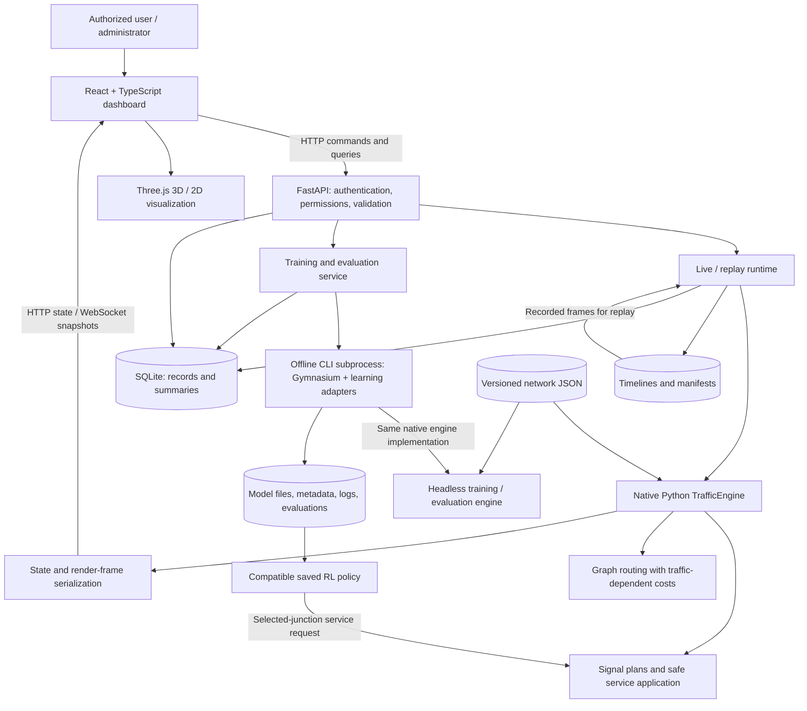

Suggested caption: **Figure 11. Current SmartFlow architecture: browser interaction and rendering, FastAPI orchestration, native traffic execution, offline learning and persistent records/artifacts.**

Required explanatory details:

- The browser renders state and sends commands; it never advances authoritative traffic physics.
- Engine time is measured in seconds with 0.1-second stepping; render refresh rate is a separate concern.
- Live runtime and training orchestration are process-local. Use one API worker. A process-local admission guard allows one compute workload; concurrent independent API runs are not a demonstrated feature.
- Offline learning subprocesses instantiate headless native engines; they are not shared-memory copies of the live engine.
- Replay reads recorded frames and does not retrain a policy or rerun traffic physics.
- SQLite stores records/metadata; large evidence/artifacts remain files. Backup/restore must preserve the supported referenced files as well as the database.
- Field Observer is separate; its provisional packages do not currently flow automatically into the simulation.

### 4.2 Additional diagram - observation preparation boundary

```mermaid
flowchart LR
    VIDEO["Stationary phone recording"] --> OBS["Separate offline Field Observer environment"]
    OBS --> RAW["Detector / tracker proposals and original timestamps"]
    RAW --> REVIEW["Manual classification, correction and coverage review"]
    REVIEW --> PROV["Immutable provisional observation revision"]
    PROV -.->|"Independent field audit: pending"| AUDIT["Audited reference measurements"]
    AUDIT -.->|"Versioned native adapter: proposed"| MAP["Site / category / demand mapping"]
    MAP -.->|"Compatible inputs after necessary conversion"| IMPORT["Existing CSV importer / supported explicit schedules"]
    IMPORT --> SC["Saved native scenario with provenance"]
```

Caption: **Offline observation preparation and its current integration boundary. Dashed links identify the audit and conversion stages still to be completed.**

The existing importer already accepts compatible CSVs prepared by a researcher. That does not mean it accepts rich Field Observer packages automatically. Gate A concerns raw automatic accuracy if automatic acceptance is sought; Gate B concerns independently reviewed final measurements. Manual reconciliation can support a valid reference even when automatic detection is inadequate.

### 4.3 Figure 12 - conceptual research framework

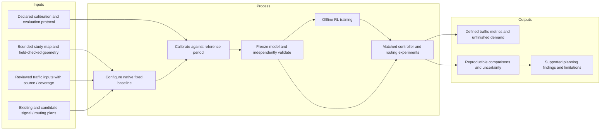

Caption: **Figure 12. Proposed research framework connecting observed inputs, baseline validity, learning and comparative planning evidence.**

This diagram is a methodological framework, not proof that calibration/validation has passed. The current app supports synthetic training before those gates. Describe that capability as software verification and distinguish it from final field-informed research training.

### 4.4 Figure 13 - use-case drawing specification

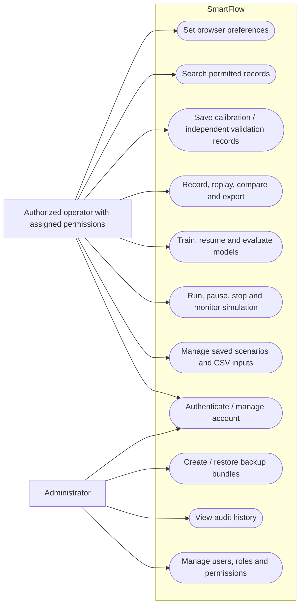

Caption: **Figure 13. User workflows and administrative operations, subject to configured permissions.**

Administrators can also perform permitted operational workflows. The seeded technical roles are `admin` and `user`; “researcher,” “planner” and “CTTMO personnel” are audience descriptions, not three separately implemented default roles. If additional roles are configured for the study, document their actual privilege matrix.

### 4.5 Figure 14 - context-level flow

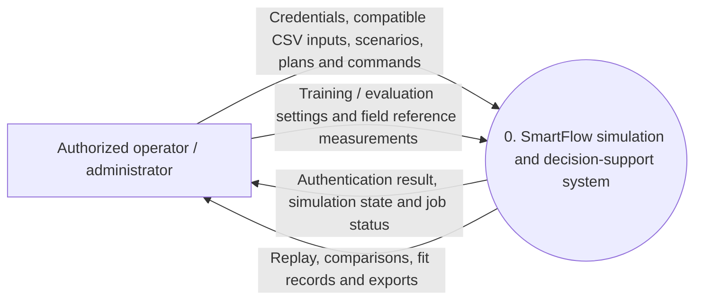

Caption: **Figure 14. External inputs and outputs across the SmartFlow system boundary.**

SQLite and the native engine are internal components, so they should not appear as external actors in this context diagram. This figure does not imply direct access to road sensors or automatic control of physical lights.

### 4.6 Figure 15 - Level 1 data-flow drawing specification

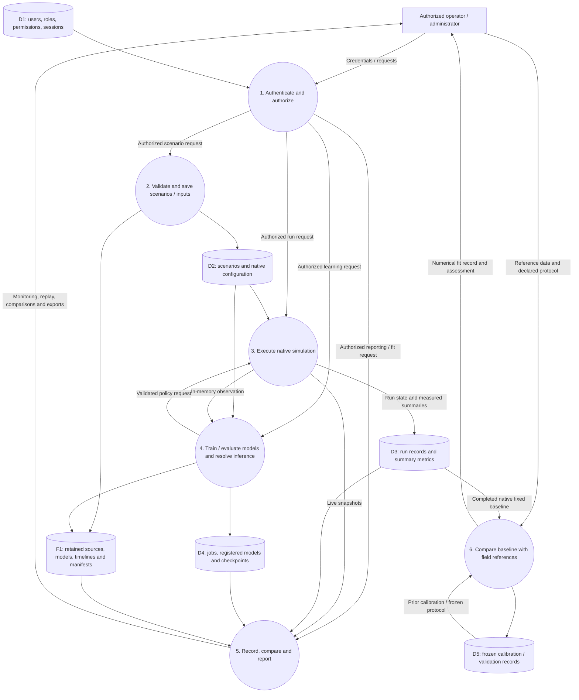

Caption: **Figure 15. Scenario, simulation, learning and research-evidence data flows. D1-D5 are logical record groups in the same SQLite database; F1 denotes external artifacts.**

P6 is also subject to authentication/permissions; its direct reference-input arrow specifies the data supplied, not a bypass of P1. Training within P4 uses its own headless engine instances; the P3/P4 observation/action loop depicts inference. Administrative audit/backup flows may be drawn as a supplemental operations DFD rather than crowding this core figure.

### 4.7 Figure 16a - account and administration ERD

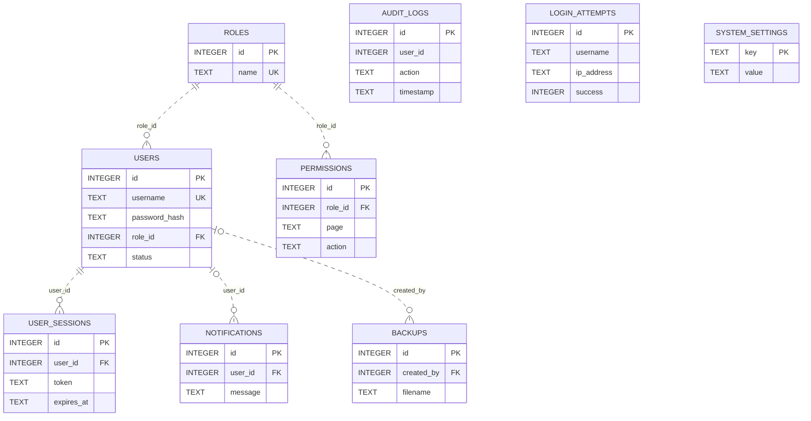

### 4.8 Figure 16b - scenarios, runs and calibration ERD

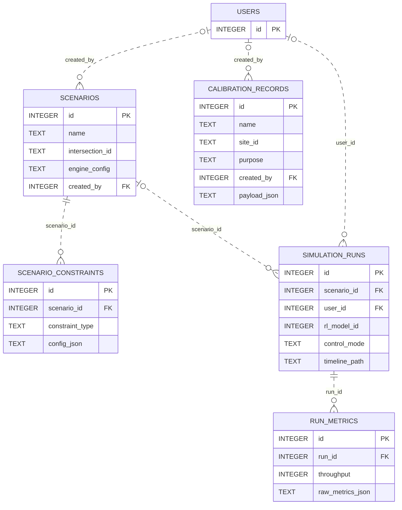

### 4.9 Figure 16c - learning records ERD

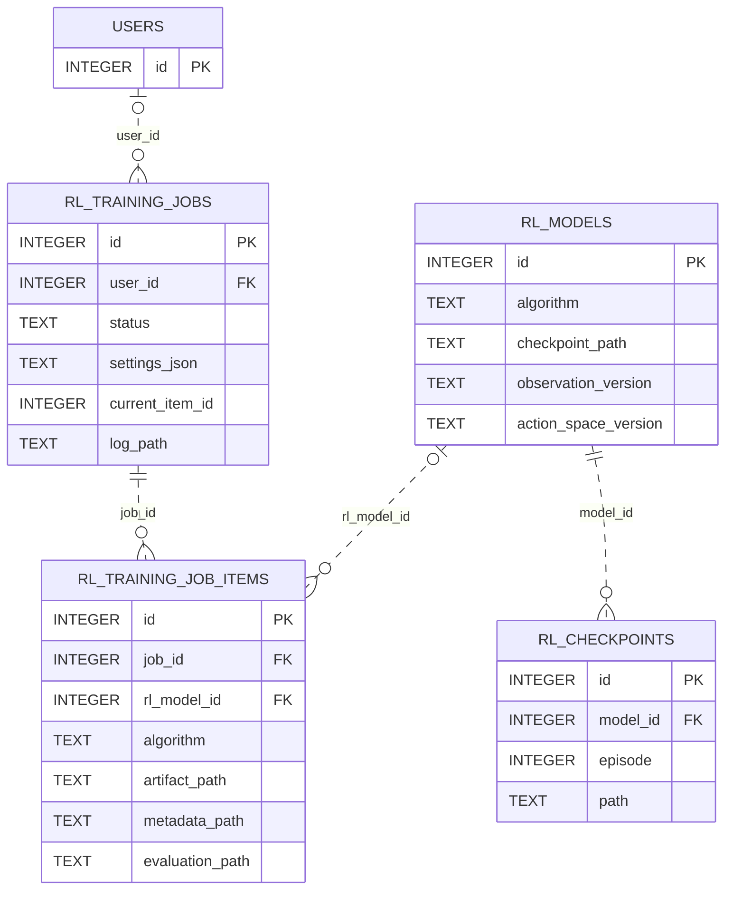

Combined caption: **Figure 16a-c. Current source-defined SQLite schema, grouped for readability. Attributes show representative keys; the complete dictionary is in Section 10.**

The three ERDs contain all 18 distinct tables. Relationships show the 15 **declared SQL foreign keys**. `..` denotes a non-identifying relationship: each child has its own primary key. It does **not** mean the SQL foreign key is absent. Nullable foreign keys allow zero or one parent; required foreign keys require one parent. Child collections allow zero or more records.

### 4.10 Supplemental diagram - application links and artifact references

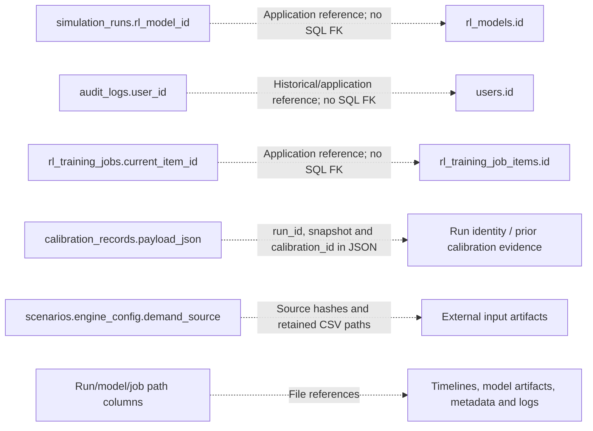

Do not draw those dashed application links as declared SQL foreign keys. A calibration record retains a frozen snapshot even when the referenced run is deleted; its run link is not a SQL cascade relationship. There is no physical `study_sites` table or SQL FK behind `site_id` in the current schema.

### 4.11 Figures 17-21 - technology and learning figures

| Existing figure | Required replacement/change |
| --- | --- |
| **17: SUMO**, around pages 57-58 | Replace the current-system SUMO screenshot/logo with a native-engine workflow or accurately labeled current simulation screenshot. A literature SUMO figure may remain in related work. |
| **18: RL**, around pages 58-59 | Use the learning/inference distinction below. Show supported service requests and native safety processing rather than arbitrary lamp changes. |
| **19: Python and TraCI**, around pages 59-60 | Replace TraCI with a diagram of React HTTP/WebSocket interaction with FastAPI/native services. |
| **20: PyTorch**, page 61 | Retain PyTorch if needed; describe DQL as SB3 DQN and PPO as SB3 PPO using PyTorch. Q-learning is tabular and should not be described as a neural-network method. |
| **21: DBMS**, page 62 | Retain SQLite as the DBMS; accompany it with the actual ERD and database-plus-artifact storage explanation. |

Replacement learning/inference diagram:

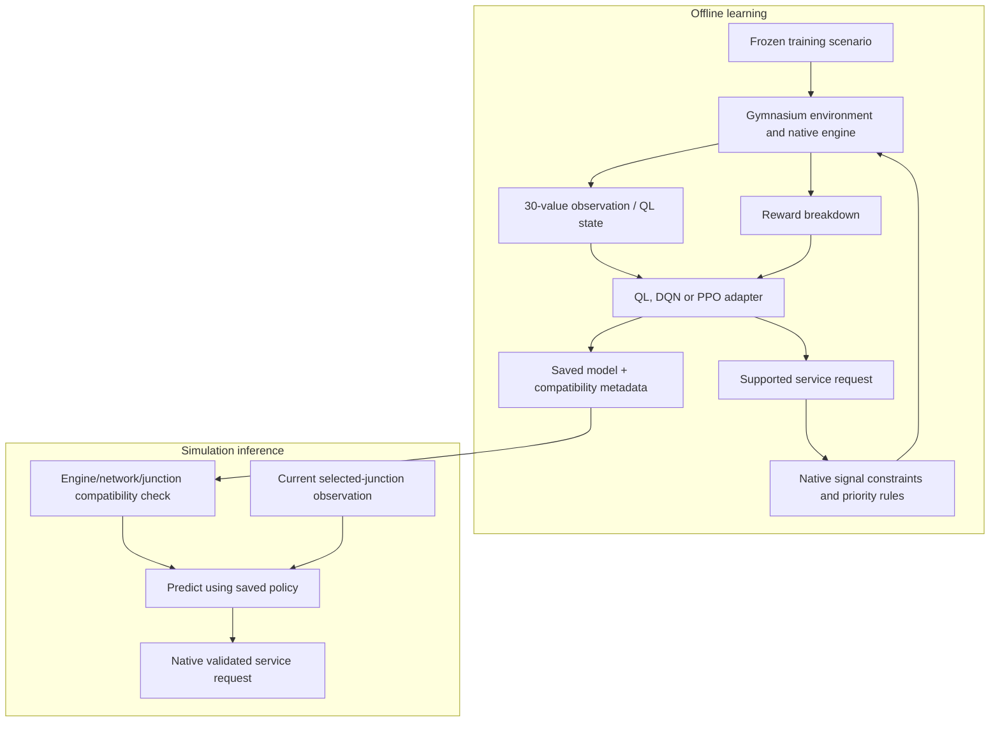

Caption: **Offline policy learning and compatible-policy inference during simulation. Inference does not imply online parameter training.**

## 5. Exact database changes to the manuscript

### 5.1 Which database should be documented?

Document the **SQLite database managed by this SmartFlow repository's `database.py`**. The default path is `data/smartflow.db`, overridable through `SMARTFLOW_DB_PATH`. Do not use the historical parent application's database as the current schema, and do not propose switching DBMS merely to align with the old diagram.

The source-defined current schema has **18 tables, 162 columns after the scenario migration, and 15 declared foreign keys**. These counts were verified by executing the schema in an isolated **in-memory** SQLite connection, then applying the source's `engine_config` addition. The live research database was not opened. Older existing databases can have historical data/state; describe the schema expected after current initialization/migrations, not an uninspected database dump.

Connections enable foreign keys, WAL mode and a busy timeout. This improves local operation but does not make process-local live/training state shared between multiple API workers.

### 5.2 Replace the old eight-entity mapping

| Old manuscript entity/table | Current representation | Exact manuscript correction |
| --- | --- | --- |
| `USERS_ACCOUNTS` / User | `users`, `roles`, `permissions`, `user_sessions` | Use actual names/keys. Replace `password` with `password_hash`; add full name/email/status, role membership, password-change flag and session lifecycle. |
| `TRAFFIC_SCENARIOS` | `scenarios` | Replace `scenario_id` with `id`, `scenario_name` with `name`, `pedestrian_demand` with `pedestrian_density`, `emergency_condition` with `emergency_mode`. Include `engine_config`, network selection, ownership, timestamps and official/archive flags. |
| `ROAD_CONSTRAINTS` | `scenario_constraints` exists; active native events/settings live inside `scenarios.engine_config` | Remove the implied standalone road-constraint record selected by each run. Explain closure/reopening/speed events and their native lane IDs. Do not imply old detailed accident/flood JSON is an active native model. |
| `SIGNAL_CONTROL_MODES` | `simulation_runs.control_mode`, optional model reference, and `engine_config.signal_plans` / `controlled_junction` | Remove the nonexistent separate mode table and `control_mode_id` FK. Record the actual controller identity and per-junction plans. |
| `SIMULATION_RUNS` | `simulation_runs` | Use `id`, `user_id`, `scenario_id`; remove nonexistent `constraint_id` and `control_mode_id`. Add run mode, controller/model identity, seed, duration/status, timeline path and baseline/favorite flags. |
| `TRAFFIC_METRICS` | `run_metrics` | Use actual metric-column names and `raw_metrics_json`. Correct cardinality to one run with zero or more stored summaries; the current getter selects a latest summary. No `UNIQUE(run_id)` enforces one-to-one. |
| `RL_OUTPUTS` | No literal equivalent SQL table | Describe models/checkpoints/jobs/items plus files containing learning summaries and recorded policy decisions. Do not claim every state-action-reward transition is persisted as a row. |
| `PERFORMANCE_REPORTS` | No literal equivalent SQL table | Reports/exports are derived from stored run metrics and relevant artifacts; evaluator writes JSON summaries. Remove a fabricated report-row relationship unless implemented later. |

### 5.3 Add the omitted tables and explain their purposes

| Table | Purpose | Important relationship/representation |
| --- | --- | --- |
| `roles` | Technical role definitions; default roles `admin` and `user`. | Referenced by `users.role_id` and `permissions.role_id`. |
| `permissions` | Page/action privileges for a role. | SQL FK to roles; backend checks permissions. |
| `user_sessions` | API session tokens and expiry. | Required user FK; cookie-based API authentication. |
| `audit_logs` | Historical user/system actions. | Optional `user_id` is an application reference, not declared FK. |
| `login_attempts` | Login outcome/IP/time records for lockout handling. | Username text; no user FK. |
| `rl_models` | Registered algorithm/artifact/version and compatibility/evaluation metadata. | Artifact path and JSON metadata fields; file-side native contract remains important. |
| `rl_checkpoints` | Episode/reward/loss/epsilon and checkpoint file reference. | Required model FK, cascade on model deletion. |
| `rl_training_jobs` | Requested workload, settings snapshots, stage/progress/status and log reference. | Optional user FK; `current_item_id` is not declared FK. |
| `rl_training_job_items` | Per-algorithm job execution, progress and result/artifact references. | Required job FK; optional model FK. |
| `calibration_records` | Frozen calibration or validation evidence and comparisons. | User FK only; site/run/parent links and measurements are JSON content. |
| `notifications` | User notifications. | Optional user FK with cascade deletion. |
| `system_settings` | System key/value settings. | `key` is the primary key; this is not a per-user theme table. |
| `backups` | Backup filename, creator and size metadata. | Optional creator FK; backup payload is an external file. |

Together with `users`, `scenarios`, `scenario_constraints`, `simulation_runs` and `run_metrics`, these are the 18 current tables.

### 5.4 Dictionary corrections that matter

1. **`engine_config` comes from a migration.** Reading only `CREATE TABLE scenarios` misses it. Document the post-initialization schema.
2. **JSON columns are SQL `TEXT`.** There are no SQL `JSON`-typed columns in this schema. JSON validity and native semantics are checked in application paths; do not invent `json_valid` constraints.
3. **Dates/times are generally SQL `TEXT`.** Do not label every stored timestamp `DATETIME`. Collection timestamps inside research JSON require UTC offsets through request validation; SQL audit/default timestamps follow the code's convention.
4. **SQL `TEXT` is not a declared `VARCHAR(50/100/255)`.** Separate actual API length limits from nonexistent database length constraints. The CSV importer has its own limits; these are not column widths.
5. **Uniqueness must be accurate.** `roles.name`, `users.username` and `users.email` have unique constraints; `run_metrics.run_id` and `user_sessions.token` are not uniquely constrained in the source schema. `system_settings.key` is a primary key.
6. **Nullable FKs matter.** Anonymous/headless/system-origin records can lack a user or scenario where the schema permits it. Do not claim every run has a required user/scenario FK.
7. **Default values are not measured results.** `run_metrics.emergency_clearance_time` and `signal_phase_efficiency` exist, but inspected native save paths do not compute/populate them and leave their defaults. Do not interpret their zero defaults as measured emergency clearance or signal efficiency. Actual emergency-wait measures are separate raw metrics.
8. **Settings storage is mixed.** The default visualization and appearance settings use browser storage; system key/value settings use SQLite. A preference UI is not proof of server-side per-user preference rows.

### 5.5 Describe nested configuration and frozen evidence

`scenarios.engine_config` preserves the native scenario contract. Explain these groups rather than pretending they are separate SQL tables:

- Network/controlled junction and supported signal plans, including modes, phase order, timing limits and offsets.
- Initial closures/speed restrictions and timestamped lane events.
- Vehicle mix, explicit vehicle/pedestrian trips and demand windows.
- Routing mode, reroute interval and minimum improvement threshold.
- Supported pedestrian/traffic limits and behavior parameters.
- `demand_source`, including synthetic/observed declaration, source description, dataset identity, retained path, hashes, collection period and conversion assumptions.

`calibration_records.payload_json` preserves request and assessment details: source kind/reference/hash; collection period; baseline run/seed/scenario; measurement start/duration; definitions, units and tolerances; manually supplied local measurements where needed; observed/simulated differences; reviewer notes; frozen experiment/metric snapshot; and prior calibration identity for validation. The API checks baseline status/provenance, population, frozen structural settings and independent sources/periods. It does not certify field truth or automatically optimize parameters.

### 5.6 Explain artifact storage separately from SQL

| Artifact | Current representation | What the manuscript must say |
| --- | --- | --- |
| Native map/network | Versioned network JSON under `data/networks/`. | Road topology is not stored as a SQL intersection/lane table. |
| Retained imported observations | Hash-named CSVs under the import directory; source metadata in `engine_config`. | Hashes identify input bytes; they do not establish accuracy. |
| Model/checkpoint weights | Files referenced by registry/checkpoint paths, with native compatibility metadata. | A registry row is not the actual learned policy. |
| Training/evaluation inputs | Frozen scenario files and job settings/snapshot metadata. | Training uses immutable input snapshots rather than silently changing saved scenarios. |
| Learning logs/evaluation summaries | Files referenced by job items and generated evaluation paths. | Evaluation results are not a dedicated `performance_reports` SQL table. |
| Recording/replay | JSONL or compressed JSONL plus manifest referenced by the run. | Playback reads recorded frames; identity/version/completeness checks matter. |
| Calibration evidence | Frozen JSON in SQLite plus CSV/JSON exports. | Referenced original field sources may need separate retention; a saved numerical fit is not raw footage. |
| Field Observer footage/revisions | Separate local workspace with source/timestamp/review/quality artifacts. | Provisional packages are not automatically ingested into the native app or necessarily covered by its backup bundle. |
| Backups | Coherent SQLite snapshot plus supported referenced artifacts/network in a bundle. | Retain raw research footage independently and rehearse restore; a source-only Git clone is not a complete research backup. |

Suggested replacement for the ERD/DBMS introduction:

> SmartFlow uses SQLite for account, permission, scenario, run, model-registry, job and research-evidence records. Its current schema comprises 18 tables. Native scenario settings are preserved as validated JSON text, while models, retained input files, recordings, manifests and evaluation artifacts are stored separately and referenced by records or metadata. Declared foreign keys are distinguished from application-level links and references contained in JSON. Calibration records retain frozen baseline evidence so that later changes or removal of a source run do not silently rewrite an existing fit assessment.

### 5.7 Tables that would belong to a future design, not the current ERD

Do not present proposed `study_sites`, `observation_datasets`, `observation_revisions`, `audit_results`, `experiments` or `signal_recommendations` tables as implemented. A future integration may introduce such entities or use versioned artifact manifests and existing records. That design decision should follow the pilot and required lineage/query needs. This guide authorizes no database migration.

## 6. Rewrite data collection, RL, metrics and evaluation

### 6.1 Two data streams, not one

Replace the pages 55-57 description that only discusses SUMO-generated collection with two distinct streams:

1. **Field/reference data:** geometry/control observations, reviewed vehicle/pedestrian counts, movements, queues and timing from actual recorded periods. Record source, clock, coverage, uncertainty, missingness and measured/inferred status.
2. **Simulation data:** native state/metrics generated from a frozen scenario, used for visualization, RL observations/reward and experimental results.

Suggested replacement:

> Field observations provide the inputs and reference measurements used to assess the study model. Offline detector/tracker outputs assist the review process but remain proposals until independently reviewed. The simulation then generates its own traffic states and performance measures from the saved configuration. These generated states form the RL environment and are distinct from real-road measurements. Calibration uses one reference period; validation uses independent evidence under a frozen structural model and measurement protocol.

The current count importer distributes aggregate counts evenly within each bin as cars. Explicit trip CSVs preserve supported vehicle class and entry time. Native categories are car, motorcycle, tricycle, bus, truck and emergency. Jeepney/bicycle/other observer categories require justified mapping or necessary model extensions. Pedestrian inputs currently identify time/junction, not a specific crosswalk/direction. A local visible turn is not a directly observed full boundary OD trip.

One phone means each fixed take observes one view during its own period. Sequential takes are not simultaneous network evidence. Missing or occluded counts remain unknown; they must not become zero or a claim of complete demand.

### 6.2 Describe the actual RL interface

The current native contract is `native-local-30-v1` for observations and `protected-service-5-v1` for actions, tied to engine/network identity and trained-junction compatibility.

| Observation group | Values |
| --- | ---: |
| Current service-family one-hot encoding | 5 |
| Normalized elapsed and remaining switching time | 2 |
| Queues for north/east/south/west approaches | 4 |
| Average stopped wait for those approaches | 4 |
| Active incoming vehicle counts for those approaches | 4 |
| Waiting pedestrian count at the controlled junction | 1 |
| Emergency presence by approach | 4 |
| Emergency proximity by approach | 4 |
| Network-family encoding | 2 |
| **Total** | **30** |

Supported actions, in index order: `SERVE_NORTH`, `SERVE_EAST`, `SERVE_SOUTH`, `SERVE_WEST`, `SERVE_PEDESTRIAN`. These request service; they do not directly set lamps. A valid-action mask is reported and native control validates requests. Avoid implying every algorithm implements identical action-masking internally.

There is no separate explicit density or road-closure flag in this 30-value vector. Constraints affect the simulated traffic and configuration but must not be listed as direct vector features unless added and versioned. Several reward summaries are whole-network measures even though approach observations/action scope are local; describe this scope honestly rather than calling the reward entirely junction-local.

The current reward combines normalized completed-trip increments with penalties for mean stopped wait, average/max queue, waiting pedestrian count, critical emergency proximity and switching. The component weights in `rl_reward.py` are respectively `0.5`, `1.0`, `0.8`, `0.4`, `0.5`, `1.5` and `0.05`. Pedestrian-count penalty is not the same as a pedestrian-delay-in-seconds penalty. Provide the exact normalization/weight definitions in the methodology if reporting that reward; do not substitute a generic waiting-time-only equation.

DQL uses `stable_baselines3.DQN` with PyTorch. PPO also uses the learning framework; QL is tabular. Training proceeds offline using frozen scenario snapshots and separate evaluation settings. A saved compatible policy predicts actions during simulation. Successful short training proves execution, not convergence, optimality or generalization.

If the observed site requires new movement groups/geometry/actions, revise the native control and RL contracts together, update serializers/renderers/replay metadata and retrain compatible artifacts. Existing policies must not be relabeled to bypass compatibility checks.

### 6.3 Replace ambiguous metric definitions

| Measure | Actual current meaning | Revision needed |
| --- | --- | --- |
| `throughput` | Completed network-boundary trips during the measurement window. | Do not define it as the count crossing a local stop line. Use separately matched local passage/discharge measures for field comparisons. |
| `throughput_per_hour` | Completed boundary trips scaled by elapsed measurement time. | Report window and rate units; distinguish it from raw count. |
| `avg_wait` | Accumulated stopped wait of completed and active admitted vehicles divided by their count. Pending arrivals are excluded. | State population and stopped-speed threshold; include boundary/pending measures separately. |
| `avg_queue` | Time average of stopped counts per incoming signal lane, excluding connectors. | Distinguish from instantaneous approach queue and total network queue. |
| `max_queue` | Maximum observed stopped lane count during sampled measurement ticks. | State lane/count meaning rather than physical queue length in metres. |
| `avg_travel_time` | Mean full travel time for trips completing in the measurement window. | State that unfinished trips are excluded and warmup-born trips may complete in the window. |
| `avg_ped_delay` | Accumulated wait of completed and active pedestrians divided by their count. | It is waiting delay, not crossing duration. |
| `density_vehicles_per_km` | Active vehicle count divided by modeled lane length. | State spatial scope and lane-kilometre denominator. |
| Lane exits / junction passages | Native local counters exist. | Define actual counting location, movement/category/window and align them with field evidence before using them for validation. |
| Unfinished/pending/dropped demand | Explicit traffic accounting measures. | Include them in results; a completed-trip average alone can favor a controller that leaves many vehicles unfinished. |
| Conservation errors | Vehicle/pedestrian accounting residuals. | Zero establishes accounting consistency, not realistic capacity or detector accuracy. |
| Signal efficiency / emergency clearance | Legacy summary columns exist but are not computed by the inspected native save paths. | Remove unsupported result claims or implement/define the intended measure; do not report default zero as a field result. |

### 6.4 Evaluation and signal-planning method

Specify the actual baseline, geometry/control assumptions, calibration and validation periods, primary outcome, tolerances, warmup/measurement/cutoff rules, repetitions/seeds, training/evaluation separation and uncertainty method. These values require study decisions, not invented defaults from this guide.

The current evaluator already runs repeated controllers and produces mean/min/max/standard-deviation summaries. Extend the final analysis with matched/paired effect estimates and uncertainty where the study protocol requires them. Do not say evaluation is absent; distinguish implemented evaluation mechanics from completed research results.

Compare signal strategies while preserving relevant exogenous inputs. Test routing changes separately with signal control fixed. For signal-planning cases, document existing/unsignalized operation and supported proposed fixed/RL alternatives. The all-way-stop mode is a modeled alternative, not proof of the actual existing unsignalized behavior. The shared emergency/pedestrian/starvation safety rules must be disclosed in baseline and RL cases.

Recommendations can be positive, negative or inconclusive. They support bounded simulation findings; physical installation/actuation is outside the present system and requires separate engineering review.

## 7. Testing, security, maintenance and operations revisions

### 7.1 Testing and implementation, pages 62-64

Separate five evidence categories: software unit/integration tests; browser workflow acceptance; traffic accounting/safety behavior; field accuracy/baseline validity; and controller comparative effectiveness. A pass in one category does not establish another.

A manuscript test table should identify requirement/objective, test procedure, inputs/site, expected behavior, dated result, evidence artifact and remaining limitation. Report fresh counts with dates and scope. Do not reuse historical “40 passed,” “107 passed” or smoke-training output as a current research conclusion.

State the deployment actually demonstrated. Local browser operation remains consistent with a local prototype. The documented hosted direction is a bounded single-worker/single-operator compute trial; no provider/hostname or independent multi-user simulation capacity should be invented.

### 7.2 Security, pages 65-68

Resolve the page 46 claim that RBAC is absent. Describe implemented backend account/session/permission checks, password hashing, login-attempt handling, account status, audit records, request/input validation and deployment configuration. Default technical roles are administrator (`admin`) and standard user (`user`). Audience job titles are not additional seeded roles.

Do not describe hashing as reversible password encryption. Do not claim the mere presence of a token table proves encrypted-at-rest sessions or exported-file encryption. “Secure communication between SUMO/TraCI” must be replaced with the actual API/browser boundary and any demonstrated HTTPS deployment configuration. Keep exact ISO framework/version/control mappings subject to verification; following selected practices does not establish certification.

### 7.3 Maintenance, pages 64 and 68-70

Replace SUMO/TraCI maintenance tasks with native engine/control regression verification, API/frontend contract checks, model compatibility/retraining, network/observation provenance, artifact retention, backup/restore rehearsal and bounded-runtime recovery. Record what happens after failure: startup reconciliation and restart do not imply exact mid-run resumption.

Back up coherent database/artifact sets and retain raw field footage independently. Preserve the original manuscript files and historical model/recording identities; changing the engine/network does not make old artifacts compatible.

## 8. Editorial corrections and bibliography review

- Fix the unrelated airport text on page 45 and garbled system names on page 40.
- Use consistent terms: native engine, selected junction, simulation-generated data, field observation, graph routing, supported service request, calibration, independent validation and bounded planning finding.
- Use future tense for proposed field/model extensions, present tense for implemented behavior, and past tense only for actual completed procedures/results with dates.
- Reconcile repeated Kodama entries [6], [20] and [32]. Check the different [7]/[21] author/title entries using the same arXiv identifier.
- Correct the page 4 citations: [19] identifies an IoT traffic paper rather than the claimed DNSC agenda; [16] does not identify the claimed CHED source.
- Verify references against originals before judging authenticity or copying performance claims. This guide flags internal inconsistencies; it does not certify the bibliography.
- Update the list of figures/tables, captions, cross-references, abbreviations and technology definitions after replacing diagrams and dictionary tables.

## 9. Completion checklist for the manuscript revision

- [ ] Title/scope clearly separate RL signal control and graph routing.
- [ ] All six objectives have a software/evidence status and a defined completion criterion.
- [ ] Current-system SUMO/TraCI claims are replaced; literature/history references remain correctly contextualized.
- [ ] Figures 7-10 reflect actual responsibilities/tasks/dates; Figures 11-21 match the intended current/proposed descriptions.
- [ ] Figure 16 uses the current 18-table schema, accurate nullable relationships and 15 declared FKs.
- [ ] The dictionary includes the migrated `engine_config` column and actual SQL types/constraints.
- [ ] JSON/application links and external files are distinguished from SQL relationships.
- [ ] No one-to-one metric constraint or nonexistent mode/report/RL-output table is claimed.
- [ ] Actual technical roles and storage of browser preferences are documented correctly.
- [ ] Field-input and simulation-output collection are separate; provisional detector outputs remain labeled.
- [ ] Current engine/phase/action/vehicle/pedestrian limits are disclosed.
- [ ] Metrics/populations/windows and unfinished demand are defined consistently.
- [ ] Calibration, independent validation and final comparisons have real evidence or an explicit pending status.
- [ ] Default legacy metric values are not presented as measured results.
- [ ] Security/deployment/maintenance claims match demonstrated operation.
- [ ] Page 45/page 40 contamination and citation inconsistencies are corrected.
- [ ] New manuscript revision is saved separately from the archived original/revised PDFs.

Recommended order: correct architecture/terminology/DB/editorial errors now; settle study decisions and pilot/model requirements; complete field review and baseline validity; run final experiments; then write supported findings and update all completion claims.

## 10. Complete current SQLite data dictionary

The tables below are generated from the source-defined schema in memory, including the scenario migration. “Explicit NOT NULL” reports that exact declaration; primary keys are identified separately. Integer primary keys receive generated identities, and absence of an explicit NOT NULL clause is not an API promise to accept null. In particular, the TEXT primary key of `system_settings` has no explicit NOT NULL clause, so do not invent one in the dictionary. Foreign-key deletion actions and unique constraints are stated exactly. Application-level bounds, JSON structures, purpose checks and artifact identity rules are additional contracts.

### `audit_logs`

Historical user/system actions; user_id is not a declared SQL FK.

| Column | SQL type | Explicit NOT NULL | Default | Keys / constraints | Meaning |
| --- | --- | --- | --- | --- | --- |
| `id` | `INTEGER` | No | - | PK; AUTOINCREMENT | Record identity. |
| `user_id` | `INTEGER` | No | - | - | Associated user identity. |
| `action` | `TEXT` | Yes | - | - | Audit action identifier. |
| `target` | `TEXT` | No | - | - | Affected resource. |
| `details` | `TEXT` | No | - | - | Audit description. |
| `ip_address` | `TEXT` | No | - | - | Recorded client IP address. |
| `user_agent` | `TEXT` | No | - | - | Recorded request user-agent where supplied. |
| `timestamp` | `TEXT` | No | `datetime('now')` | - | Event timestamp. |

### `backups`

Backup file metadata; the actual snapshot/bundle is an external file.

| Column | SQL type | Explicit NOT NULL | Default | Keys / constraints | Meaning |
| --- | --- | --- | --- | --- | --- |
| `id` | `INTEGER` | No | - | PK; AUTOINCREMENT | Record identity. |
| `filename` | `TEXT` | Yes | - | - | External backup/bundle filename. |
| `created_by` | `INTEGER` | No | - | FK `users.id`; DELETE NO ACTION | Creator/reviewer user identity. |
| `created_at` | `TEXT` | No | `datetime('now')` | - | Record creation timestamp. |
| `size_bytes` | `INTEGER` | No | `0` | - | Recorded file size. |

### `calibration_records`

Frozen calibration or validation comparisons; run/parent/source details are nested JSON, not separate FK columns.

| Column | SQL type | Explicit NOT NULL | Default | Keys / constraints | Meaning |
| --- | --- | --- | --- | --- | --- |
| `id` | `INTEGER` | No | - | PK; AUTOINCREMENT | Record identity. |
| `name` | `TEXT` | Yes | - | - | Human-readable record name. |
| `site_id` | `TEXT` | Yes | - | - | Declared site label; no SQL study_sites table/FK. |
| `purpose` | `TEXT` | Yes | - | CHECK IN ('calibration', 'validation') | calibration or validation, enforced by SQL CHECK. |
| `created_by` | `INTEGER` | No | - | FK `users.id`; DELETE SET NULL | Creator/reviewer user identity. |
| `created_at` | `TEXT` | No | `datetime('now')` | - | Record creation timestamp. |
| `payload_json` | `TEXT` | Yes | - | - | Frozen baseline snapshot, sources, protocol, measurements, comparisons and assessment. |

### `login_attempts`

Authentication outcomes grouped by supplied username, IP and time.

| Column | SQL type | Explicit NOT NULL | Default | Keys / constraints | Meaning |
| --- | --- | --- | --- | --- | --- |
| `id` | `INTEGER` | No | - | PK; AUTOINCREMENT | Record identity. |
| `username` | `TEXT` | Yes | - | - | Supplied login name; not a user FK. |
| `ip_address` | `TEXT` | No | - | - | Recorded client IP address. |
| `timestamp` | `TEXT` | No | `datetime('now')` | - | Event timestamp. |
| `success` | `INTEGER` | Yes | `0` | - | Integer authentication-success flag. |

### `notifications`

User-associated notification messages and read state.

| Column | SQL type | Explicit NOT NULL | Default | Keys / constraints | Meaning |
| --- | --- | --- | --- | --- | --- |
| `id` | `INTEGER` | No | - | PK; AUTOINCREMENT | Record identity. |
| `user_id` | `INTEGER` | No | - | FK `users.id`; DELETE CASCADE | Associated user identity. |
| `message` | `TEXT` | Yes | - | - | Human-readable message/status detail. |
| `type` | `TEXT` | No | `'info'` | - | Notification category. |
| `read` | `INTEGER` | No | `0` | - | Integer read/unread flag. |
| `created_at` | `TEXT` | No | `datetime('now')` | - | Record creation timestamp. |

### `permissions`

Role-based page/action privileges.

| Column | SQL type | Explicit NOT NULL | Default | Keys / constraints | Meaning |
| --- | --- | --- | --- | --- | --- |
| `id` | `INTEGER` | No | - | PK; AUTOINCREMENT | Record identity. |
| `role_id` | `INTEGER` | Yes | - | FK `roles.id`; DELETE NO ACTION | Technical role membership/reference. |
| `page` | `TEXT` | Yes | - | - | Permission resource/page identifier. |
| `action` | `TEXT` | Yes | `'view'` | - | Permitted operation, such as view/run/edit/export. |

### `rl_checkpoints`

Per-model learning checkpoint metadata and file references.

| Column | SQL type | Explicit NOT NULL | Default | Keys / constraints | Meaning |
| --- | --- | --- | --- | --- | --- |
| `id` | `INTEGER` | No | - | PK; AUTOINCREMENT | Record identity. |
| `model_id` | `INTEGER` | Yes | - | FK `rl_models.id`; DELETE CASCADE | Associated registered model. |
| `episode` | `INTEGER` | No | `0` | - | Checkpoint episode number. |
| `reward` | `REAL` | No | `0` | - | Recorded learning reward. |
| `loss` | `REAL` | No | `0` | - | Recorded loss where available. |
| `epsilon` | `REAL` | No | `1.0` | - | Recorded exploration value where relevant. |
| `path` | `TEXT` | No | - | - | External checkpoint file reference. |
| `created_at` | `TEXT` | No | `datetime('now')` | - | Record creation timestamp. |

### `rl_models`

Registered model identity, compatibility/evaluation fields and saved policy reference.

| Column | SQL type | Explicit NOT NULL | Default | Keys / constraints | Meaning |
| --- | --- | --- | --- | --- | --- |
| `id` | `INTEGER` | No | - | PK; AUTOINCREMENT | Record identity. |
| `name` | `TEXT` | Yes | - | - | Human-readable record name. |
| `algorithm` | `TEXT` | No | `'DQN'` | - | Learning algorithm identifier. |
| `version` | `TEXT` | No | `'1.0'` | - | Artifact/version label. |
| `checkpoint_path` | `TEXT` | No | - | - | Saved model/policy file reference. |
| `intersection_support_json` | `TEXT` | No | `'[]'` | - | Supported network/junction scope labels as JSON text. |
| `training_scenarios_json` | `TEXT` | No | `'[]'` | - | Training scenario metadata as JSON text. |
| `observation_version` | `TEXT` | No | `'obs_v1'` | - | Registry observation-contract label. |
| `reward_version` | `TEXT` | No | `'reward_v1'` | - | Registry reward-contract label. |
| `action_space_version` | `TEXT` | No | `'action_v1'` | - | Registry action-contract label. |
| `seed_set_json` | `TEXT` | No | `'[]'` | - | Seed-set JSON text. |
| `training_date` | `TEXT` | No | - | - | Training timestamp. |
| `best_evaluation_score` | `REAL` | No | - | - | Recorded primary evaluation score; not proof of field effectiveness. |
| `created_at` | `TEXT` | No | `datetime('now')` | - | Record creation timestamp. |

### `rl_training_job_items`

Per-algorithm execution and associated model/evaluation artifacts.

| Column | SQL type | Explicit NOT NULL | Default | Keys / constraints | Meaning |
| --- | --- | --- | --- | --- | --- |
| `id` | `INTEGER` | No | - | PK; AUTOINCREMENT | Record identity. |
| `job_id` | `INTEGER` | Yes | - | FK `rl_training_jobs.id`; DELETE CASCADE | Required parent workload. |
| `algorithm` | `TEXT` | Yes | - | - | Learning algorithm identifier. |
| `sequence_index` | `INTEGER` | Yes | `0` | - | Execution order within job. |
| `status` | `TEXT` | No | `'queued'` | - | Application-managed lifecycle state. |
| `command_json` | `TEXT` | No | `'[]'` | - | Subprocess command arguments as JSON text. |
| `progress_percent` | `REAL` | No | `0` | - | Reported execution progress; distinct from research completion. |
| `latest_episode` | `INTEGER` | No | `0` | - | Latest reported learning episode. |
| `latest_reward` | `REAL` | No | - | - | Latest reported reward. |
| `latest_epsilon` | `REAL` | No | - | - | Latest reported exploration value. |
| `latest_timesteps` | `INTEGER` | No | `0` | - | Latest reported training timesteps. |
| `artifact_path` | `TEXT` | No | - | - | Saved model/result file reference. |
| `metadata_path` | `TEXT` | No | - | - | Artifact compatibility/learning metadata reference. |
| `rl_model_id` | `INTEGER` | No | - | FK `rl_models.id`; DELETE SET NULL | Associated registered model identity. |
| `evaluation_path` | `TEXT` | No | - | - | Saved evaluation JSON reference. |
| `message` | `TEXT` | No | - | - | Human-readable message/status detail. |
| `started_at` | `TEXT` | No | - | - | Execution start timestamp. |
| `ended_at` | `TEXT` | No | - | - | Execution end timestamp. |
| `created_at` | `TEXT` | No | `datetime('now')` | - | Record creation timestamp. |

### `rl_training_jobs`

Workload request, frozen settings and stage/progress. current_item_id is not a declared SQL FK.

| Column | SQL type | Explicit NOT NULL | Default | Keys / constraints | Meaning |
| --- | --- | --- | --- | --- | --- |
| `id` | `INTEGER` | No | - | PK; AUTOINCREMENT | Record identity. |
| `user_id` | `INTEGER` | No | - | FK `users.id`; DELETE NO ACTION | Associated user identity. |
| `status` | `TEXT` | No | `'queued'` | - | Application-managed lifecycle state. |
| `selected_algorithms_json` | `TEXT` | No | `'[]'` | - | Requested algorithm-set JSON text. |
| `settings_json` | `TEXT` | No | `'{}'` | - | Validated job settings and scenario/evaluation snapshot metadata. |
| `progress_percent` | `REAL` | No | `0` | - | Reported execution progress; distinct from research completion. |
| `current_algorithm` | `TEXT` | No | - | - | Algorithm currently executing. |
| `current_item_id` | `INTEGER` | No | - | - | Current item application reference, not SQL FK. |
| `log_path` | `TEXT` | No | - | - | External execution log reference. |
| `message` | `TEXT` | No | - | - | Human-readable message/status detail. |
| `started_at` | `TEXT` | No | - | - | Execution start timestamp. |
| `ended_at` | `TEXT` | No | - | - | Execution end timestamp. |
| `created_at` | `TEXT` | No | `datetime('now')` | - | Record creation timestamp. |

### `roles`

Technical role definitions; seeded names are admin and user.

| Column | SQL type | Explicit NOT NULL | Default | Keys / constraints | Meaning |
| --- | --- | --- | --- | --- | --- |
| `id` | `INTEGER` | No | - | PK; AUTOINCREMENT | Record identity. |
| `name` | `TEXT` | Yes | - | UNIQUE | Unique technical role name. |
| `description` | `TEXT` | No | - | - | Descriptive text. |
| `created_at` | `TEXT` | No | `datetime('now')` | - | Record creation timestamp. |

### `run_metrics`

Stored run summaries and raw native JSON; run_id is not unique.

| Column | SQL type | Explicit NOT NULL | Default | Keys / constraints | Meaning |
| --- | --- | --- | --- | --- | --- |
| `id` | `INTEGER` | No | - | PK; AUTOINCREMENT | Record identity. |
| `run_id` | `INTEGER` | Yes | - | FK `simulation_runs.id`; DELETE CASCADE | Required source run; permits multiple summary rows. |
| `avg_waiting_time` | `REAL` | No | `0` | - | Stored avg_wait projection: mean stopped wait for admitted population. |
| `avg_queue_length` | `REAL` | No | `0` | - | Stored avg_queue projection: time average per incoming signal lane. |
| `max_queue_length` | `INTEGER` | No | `0` | - | Stored maximum stopped lane count. |
| `throughput` | `INTEGER` | No | `0` | - | Completed network-boundary trip count. |
| `avg_pedestrian_delay` | `REAL` | No | `0` | - | Stored mean pedestrian waiting delay. |
| `emergency_clearance_time` | `REAL` | No | `0` | - | Legacy summary column; inspected native saves leave default, not a measured clearance result. |
| `signal_phase_efficiency` | `REAL` | No | `0` | - | Legacy summary column; inspected native saves leave default, not a computed efficiency result. |
| `congestion_severity` | `TEXT` | No | `'low'` | - | Summary label; default alone is not measured evidence. |
| `raw_metrics_json` | `TEXT` | No | `'{}'` | - | Full metrics/experiment/provenance JSON text. |
| `recorded_at` | `TEXT` | No | `datetime('now')` | - | Summary storage timestamp. |

### `scenario_constraints`

Scenario-linked constraint records; native events/settings are also represented in engine_config, not inferred from this table alone.

| Column | SQL type | Explicit NOT NULL | Default | Keys / constraints | Meaning |
| --- | --- | --- | --- | --- | --- |
| `id` | `INTEGER` | No | - | PK; AUTOINCREMENT | Record identity. |
| `scenario_id` | `INTEGER` | Yes | - | FK `scenarios.id`; DELETE CASCADE | Associated saved scenario. |
| `constraint_type` | `TEXT` | Yes | - | - | Constraint category. |
| `config_json` | `TEXT` | No | `'{}'` | - | Constraint configuration JSON text. |

### `scenarios`

Saved scenarios, legacy fields and complete native engine_config.

| Column | SQL type | Explicit NOT NULL | Default | Keys / constraints | Meaning |
| --- | --- | --- | --- | --- | --- |
| `id` | `INTEGER` | No | - | PK; AUTOINCREMENT | Record identity. |
| `name` | `TEXT` | Yes | - | - | Human-readable record name. |
| `description` | `TEXT` | No | - | - | Descriptive text. |
| `traffic_density` | `TEXT` | No | `'Medium'` | - | Supported traffic preset label. |
| `pedestrian_density` | `TEXT` | No | `'Medium'` | - | Supported pedestrian preset label. |
| `emergency_mode` | `TEXT` | No | `'Disabled'` | - | Emergency-demand preset label. |
| `road_constraint` | `TEXT` | No | `'None'` | - | Legacy/simple disruption preset label. |
| `intersection_id` | `TEXT` | No | `'tagum_1'` | - | Selected network identifier; not a SQL site FK. |
| `lane_closure_config` | `TEXT` | No | `'{}'` | - | Retained legacy JSON text; not the authoritative native lane-event contract. |
| `construction_config` | `TEXT` | No | `'{}'` | - | Retained legacy construction JSON text. |
| `accident_config` | `TEXT` | No | `'{}'` | - | Retained legacy accident JSON text. |
| `flooding_config` | `TEXT` | No | `'{}'` | - | Retained legacy flooding JSON text. |
| `created_by` | `INTEGER` | No | - | FK `users.id`; DELETE NO ACTION | Creator/reviewer user identity. |
| `created_at` | `TEXT` | No | `datetime('now')` | - | Record creation timestamp. |
| `updated_at` | `TEXT` | No | `datetime('now')` | - | Last update timestamp. |
| `is_official` | `INTEGER` | No | `0` | - | Official-scenario integer flag. |
| `is_archived` | `INTEGER` | No | `0` | - | Archive integer flag. |
| `engine_config` | `TEXT` | No | `'{}'` | - | Complete validated native scenario settings and source provenance; added by migration. |

### `simulation_runs`

Execution identity, selected controller and timeline reference. rl_model_id is not a declared SQL FK.

| Column | SQL type | Explicit NOT NULL | Default | Keys / constraints | Meaning |
| --- | --- | --- | --- | --- | --- |
| `id` | `INTEGER` | No | - | PK; AUTOINCREMENT | Record identity. |
| `scenario_id` | `INTEGER` | No | - | FK `scenarios.id`; DELETE NO ACTION | Associated saved scenario. |
| `user_id` | `INTEGER` | No | - | FK `users.id`; DELETE NO ACTION | Associated user identity. |
| `run_mode` | `TEXT` | No | `'live'` | - | Execution mode, e.g. live or recorded workflow. |
| `control_mode` | `TEXT` | No | `'fixed-time'` | - | Actual controller label. |
| `rl_model_id` | `INTEGER` | No | - | - | Associated registered model identity. |
| `status` | `TEXT` | No | `'idle'` | - | Application-managed lifecycle state. |
| `start_time` | `TEXT` | No | - | - | Run start timestamp. |
| `end_time` | `TEXT` | No | - | - | Run end timestamp. |
| `duration_seconds` | `REAL` | No | `0` | - | Recorded run duration in seconds. |
| `seed` | `INTEGER` | No | - | - | Experiment seed. |
| `notes` | `TEXT` | No | - | - | Execution notes. |
| `timeline_path` | `TEXT` | No | - | - | External recording/replay artifact reference. |
| `is_baseline` | `INTEGER` | No | `0` | - | Baseline-selection integer flag. |
| `is_favorite` | `INTEGER` | No | `0` | - | Favorite integer flag. |
| `created_at` | `TEXT` | No | `datetime('now')` | - | Record creation timestamp. |

### `system_settings`

System key/value settings. Browser appearance/default visualization preferences are stored separately.

| Column | SQL type | Explicit NOT NULL | Default | Keys / constraints | Meaning |
| --- | --- | --- | --- | --- | --- |
| `key` | `TEXT` | No | - | PK | Primary setting name; explicit SQL NOT NULL is absent. |
| `value` | `TEXT` | No | - | - | String setting value. |
| `updated_at` | `TEXT` | No | `datetime('now')` | - | Last update timestamp. |

### `user_sessions`

User session token and expiry records.

| Column | SQL type | Explicit NOT NULL | Default | Keys / constraints | Meaning |
| --- | --- | --- | --- | --- | --- |
| `id` | `INTEGER` | No | - | PK; AUTOINCREMENT | Record identity. |
| `user_id` | `INTEGER` | Yes | - | FK `users.id`; DELETE NO ACTION | Associated user identity. |
| `token` | `TEXT` | Yes | - | - | Random session token; indexed but not SQL-unique. |
| `created_at` | `TEXT` | No | `datetime('now')` | - | Record creation timestamp. |
| `expires_at` | `TEXT` | No | - | - | Session expiry timestamp. |

### `users`

Accounts, password hashes, role membership and account lifecycle.

| Column | SQL type | Explicit NOT NULL | Default | Keys / constraints | Meaning |
| --- | --- | --- | --- | --- | --- |
| `id` | `INTEGER` | No | - | PK; AUTOINCREMENT | Record identity. |
| `full_name` | `TEXT` | Yes | - | - | Display name. |
| `username` | `TEXT` | Yes | - | UNIQUE | Unique login name. |
| `email` | `TEXT` | No | - | UNIQUE | Unique optional email. |
| `password_hash` | `TEXT` | Yes | - | - | Werkzeug-generated password hash; no plaintext password column. |
| `role_id` | `INTEGER` | Yes | `2` | FK `roles.id`; DELETE NO ACTION | Technical role membership/reference. |
| `status` | `TEXT` | Yes | `'active'` | - | Application-managed lifecycle state. |
| `must_change_password` | `INTEGER` | Yes | `0` | - | Integer flag requiring account password change. |
| `created_at` | `TEXT` | No | `datetime('now')` | - | Record creation timestamp. |
| `updated_at` | `TEXT` | No | `datetime('now')` | - | Last update timestamp. |
| `last_login_at` | `TEXT` | No | - | - | Last successful login timestamp. |

## 11. Source map and diagram-format references

Use these source locations when preparing the final figures and supporting text. These links point to this Windows workspace; keep repository-relative filenames in any portable manuscript reference appendix.

| What to verify | Source |
| --- | --- |
| Tables, migrations, declared relationships, defaults, seeded roles and saved metrics | [database.py](C:/Users/jhepo/Desktop/trapik2/SmartFlow/database.py) |
| Database path and runtime configuration | [config.py](C:/Users/jhepo/Desktop/trapik2/SmartFlow/config.py) |
| API boundaries and permission enforcement | [API application](C:/Users/jhepo/Desktop/trapik2/SmartFlow/backend/main.py), [security](C:/Users/jhepo/Desktop/trapik2/SmartFlow/backend/security.py) |
| Live/replay lifecycle and native metric persistence | [simulation runtime](C:/Users/jhepo/Desktop/trapik2/SmartFlow/backend/simulation_runtime.py) |
| Search and frozen calibration/validation records | [research routes](C:/Users/jhepo/Desktop/trapik2/SmartFlow/backend/research_routes.py) |
| Authoritative simulation and supported scenario settings | [traffic engine](C:/Users/jhepo/Desktop/trapik2/SmartFlow/simulation/traffic_engine.py), [scenario contract](C:/Users/jhepo/Desktop/trapik2/SmartFlow/simulation/scenario_config.py) |
| Geometry, turn connectors and graph routing | [road network](C:/Users/jhepo/Desktop/trapik2/SmartFlow/simulation/road_network.py), [network data](C:/Users/jhepo/Desktop/trapik2/SmartFlow/data/networks/tagum_network.json) |
| Observation, action, reward and artifact compatibility | [RL environment](C:/Users/jhepo/Desktop/trapik2/SmartFlow/simulation/rl_env.py), [state](C:/Users/jhepo/Desktop/trapik2/SmartFlow/simulation/rl_state.py), [reward](C:/Users/jhepo/Desktop/trapik2/SmartFlow/simulation/rl_reward.py), [model contract](C:/Users/jhepo/Desktop/trapik2/SmartFlow/simulation/model_contract.py) |
| Training orchestration and repeated controller comparisons | [training service](C:/Users/jhepo/Desktop/trapik2/SmartFlow/services/rl_training_service.py), [controller evaluator](C:/Users/jhepo/Desktop/trapik2/SmartFlow/tools/evaluate_controllers.py) |
| Observation conversion and supported backup contents | [CSV importer](C:/Users/jhepo/Desktop/trapik2/SmartFlow/services/observed_data_import.py), [backup bundles](C:/Users/jhepo/Desktop/trapik2/SmartFlow/services/backup_bundle.py) |
| Scenario editing and browser preferences | [scenarios page](C:/Users/jhepo/Desktop/trapik2/SmartFlow/src/components/scenarios-page.tsx), [native controls](C:/Users/jhepo/Desktop/trapik2/SmartFlow/src/components/native-scenario-controls.tsx), [preferences](C:/Users/jhepo/Desktop/trapik2/SmartFlow/src/lib/preferences.ts), [appearance](C:/Users/jhepo/Desktop/trapik2/SmartFlow/src/lib/appearance.ts) |
| Separate provisional video observation workflow | [Field Observer core](C:/Users/jhepo/Desktop/trapik2/SmartFlow/tools/field_observer/field_observer/core.py), [README](C:/Users/jhepo/Desktop/trapik2/SmartFlow/tools/field_observer/README.md) |

Research/process sources: [reference manuscript](C:/Users/jhepo/Desktop/trapik2/SmartFlow/FINAL_SIGURO_CHAPTER1_AND_2.docx.pdf), [research method](C:/Users/jhepo/Desktop/trapik2/SmartFlow/docs/RESEARCH_METHOD.md), [field recording protocol](C:/Users/jhepo/Desktop/trapik2/SmartFlow/docs/FIELD_RECORDING_PROTOCOL.md), [observation integration plan](C:/Users/jhepo/Desktop/trapik2/SmartFlow/docs/FIELD_DATA_SMARTFLOW_INTEGRATION.md), [video tool plan](C:/Users/jhepo/Desktop/trapik2/SmartFlow/docs/VIDEO_OBSERVATION_TOOL_PLAN.md), [research workspace](C:/Users/jhepo/Desktop/trapik2/SmartFlow/docs/RESEARCH_WORKSPACE.md), [architecture](C:/Users/jhepo/Desktop/trapik2/SmartFlow/docs/ARCHITECTURE_AND_PLAN.md), [dated progress](C:/Users/jhepo/Desktop/trapik2/SmartFlow/docs/PROGRESS_AND_HANDOFF.md), and the [separate October 8 assessment](C:/Users/jhepo/Desktop/trapik2/SmartFlow/docs/reviews/MANUSCRIPT_CODEBASE_REVIEW_2026-10-08.md). Their implementation proposals are not proof of completion.

Diagram notation references: [Mermaid ER syntax](https://mermaid.js.org/syntax/entityRelationshipDiagram.html) and [flowchart syntax](https://mermaid.js.org/syntax/flowchart.html). These support the editable drawing format, not SmartFlow's research claims.
